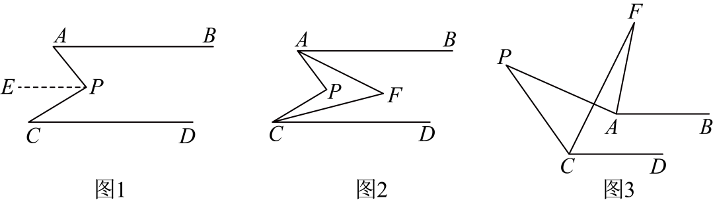

# Mathematics - 题目 115

**ID**: df2250ec854343c68573c2977c90ded1
**年级**: Grade 7
**难度**: Medium-Hard
**题型**: Calculation

## 题目
综合与探究问题情境：如图1，已知 $AB/\mskip-4mu/CD$ ，点 $P$ 的位置在平行线 $AB$ ， $CD$ 之间，连接 $PA$ ， $PC$ ，试探究 $∠APC$ 与 $∠A$ ， $∠C$ 之间的数量关系．探究发现：（1）以下是小宇的探索过程，请你结合图形仔细阅读，并完成填空．解：如图1，过点 $P$ 作 $PE/\mskip-4mu/AB$ ．$\because AB\parallel CD$ （已知），$\therefore PE\parallel CD$ ．$\therefore \angle A=\angle APE$ ， $\angle C=\angle CPE$ （      ）．$\therefore \angle A+\angle C=$+（等量代换） $=∠APC$ ．即 $∠APC$ ， $∠A$ ， $∠C$ 之间的数量关系是．（2）如图2，若 $∠PAB$ 与 $∠PCD$ 的平分线相交于点 $F$ ，请直接写出 $\angle AFC$ 与 $∠APC$ 之间的数量关系．拓展延伸：（3）如图3，已知 $AB/\mskip-4mu/CD$ ，若点 $P$ 的位置在直线 $AB$ 的上方， $∠PAB$ 与 $∠PCD$ 的平分线相交于点 $F$ ，请问（2）中的结论还成立吗？请说明理由．​​​​​​​‌

## 解答

1. 解：（1）解：如图1，过点 $P$ 作 $PE/\mskip-4mu/AB$ ．
2. $\because AB\parallel CD$ （已知），
3. $\therefore PE\parallel CD$ ．
4. $\therefore \angle A=\angle APE$ ， $\angle C=\angle CPE$ （两直线平行，内错角相等）．
5. $\therefore \angle A+\angle C=$  $∠APE∠CPE$ （等量代换） $=∠APC$ ．
6. 即 $∠APC$ ， $∠A$ ， $∠C$ 之间的数量关系是 $\angle A+\angle C=\angle APC$ ．
7. （2）如答图，过点 $P$ ，点 $F$ 分别作 $PM\mathrm{/\mskip-4mu/}AB$ ， $FN/\mskip-4mu/AB$
8. $\because AF$ ， $CF$ 分别平分 $∠PAB$ 和 $∠PCD$ ，
9. $\therefore ∠PAF=∠FAB$ ， $∠PCF=∠FCD$ ．
10. $\because PM/\mskip-4mu/AB$ ， $AB/\mskip-4mu/CD$ ，
11. $\therefore PM/\mskip-4mu/CD$ ．
12. $\therefore ∠MPA=∠PAB=2∠FAB$ ， $∠MPC=∠PCD=2∠FCD$ ．
13. $\therefore ∠APC=∠MPA+∠MPC=2∠FAB+2∠FCD=2\left ({∠FAB+∠FCD}\right )$ ．
14. $\because FN\mathrm{/\mskip-4mu/}AB$ ， $AB/\mskip-4mu/CD$ ，
15. $\therefore FN\mathrm{/\mskip-4mu/}CD$ ．
16. $\therefore ∠NFA=∠FAB,∠NFC=∠FCD$ ．
17. $\therefore ∠AFC=∠NFA+∠NFC=∠FAB+∠FCD$ ．
18. $\because ∠APC=2\left ({∠FAB+∠FCD}\right )$ ，
19. $\therefore \angle AFC=\frac {1}{2}\angle APC$ ．
20. （3）第（2）问中的结论仍然成立．
21. 理由如下：如答图，过点 $P$ ，点 $F$ 分别作 $PM\mathrm{/\mskip-4mu/}AB$ ， $FN/\mskip-4mu/AB$ ．
22. 
23. $\because AF$ ， $CF$ 分别平分 $∠PAB$ 和 $∠PCD$ ，
24. $\therefore ∠PAF=∠FAB$ ， $∠PCF=∠FCD$ ．
25. $\because PM/\mskip-4mu/AB$ ， $AB/\mskip-4mu/CD$ ，
26. $\therefore PM/\mskip-4mu/CD$ ．
27. $\therefore ∠MPA=∠PAB=2∠FAB$ ， $∠MPC=∠PCD=2∠FCD$ ．
28. $\therefore ∠APC=∠MPA-∠MPC=2∠FAB-2∠FCD=2\left ({∠FAB-∠FCD}\right )$ ．
29. $\because FN\mathrm{/\mskip-4mu/}AB$ ， $AB/\mskip-4mu/CD$ ，
30. $\therefore FN\mathrm{/\mskip-4mu/}CD$ ．
31. $\therefore ∠NFA=∠FAB,∠NFC=∠FCD$ ．
32. $\therefore ∠AFC=∠NFA-∠NFC=∠FAB-∠FCD$ ．
33. $\because ∠APC=2\left ({∠FAB-∠FCD}\right )$ ，
34. $\therefore \angle AFC=\frac {1}{2}\angle APC$ ．

## 知识点

**中文**:
  - 平行公理及推论
  - 平行线的判定与性质

**English**:
  - Parallel Axiom
  - Determination and Properties

---
