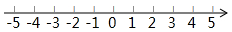

# Mathematics - 题目 640

**ID**: dfa1b5d6d6354a9eb191ef4cb963666a
**年级**: Grade 7
**难度**: Medium-Hard
**题型**: Calculation

## 题目
数轴是一个非常重要的数学工具，它使数和数轴上的点建立起一一对应的关系，揭示了数与点之间的内在联系，它是“数形结合”的基础．〖阅读〗$\left |{3-1}\right |$ 表示3与1差的绝对值，也可理解为3与1两数在数轴上所对应的两点之间的距离；​​​​​​​‌ $\left |{3+1}\right |$ 可以看做 $|3-(-1)|$ ，表示3与 $-1$ 的差的绝对值，也可理解为3与 $-1$ 两数在数轴上所对应的两点之间的距离．〖探索〗（1）数轴上表示4和 $-2$ 的两点之间的距离是．（2）①若 $|x-(-1)|=3$ ，则 $x=$；②若使x所表示的点到表示3和 $-2$ 的点的距离之和为5，所有符合条件的整数x的和为．〖动手折一折〗小明在草稿纸上画了一条数轴进行操作探究：（3）折叠纸面，若1表示的点和 $-1$ 表示的点重合，则3表示的点与表示的点重合．（4）折叠纸面，若3表示的点和 $-5$ 表示的点重合，①则10表示的点和表示的点重合；②这时如果A，B（A在B的左侧）两点之间的距离为2020且A，B两点经折叠后重合，则点A表示的数是，点B表示的数是；③若点A表示的数为a，点B表示的数为b，且A，B两点经折叠后重合那么a与b之间的数量关系是．〖拓展延伸〗（5）当 $x=$时， $|x+1|+|x-2|+|x-3|$ 有最小值，最小值是．

## 解答

1. 解：探索：（1）4-（-2）=6；
2. （2）①由材料可知 $|x-(-1)|=3$ 中x表示数轴上到-1的距离是3的数
3. ∴x=-4或2；
4. ②由题可知x所表示的数可为-2，-1，0，1，2，3
5. ∴-2-1+0+1+2+3=3
6. 〖动手折一折〗（3）由题可知折叠是点是原点
7. ∴3表示的点与-3表示的点重合
8. （4）①由题可知折叠点是-1
9. ∴10表示的点和-12表示的点重合
10. ②∵A，B（A在B的左侧）两点之间的距离为2020
11. ∴A，B（A在B的左侧）两点到-1的距离均为1010
12. ∴A表示的数=-1010-1=-1011，B表示的数=1010-1=1009；
13. ③由题意有：-1-a=b+1即b+a=-2
14. 〖拓展延伸〗
15. （5）根据材料可知 $|x+1|+|x-2|+|x-3|$ 表示数轴上一数x到-1和2和3的距离和，当x=2时，式子有最小值，最小值为4
16. 故答案为：探索：（1）6；（2）①-4或2；②3；动手折一折：（3）-3；（4）①-12；②-1011，1009；③b+a=-2；拓展延伸：（5）4

## 知识点

**中文**:
  - 利用数轴比较有理数的大小
  - 用数轴上的点表示有理数
  - 数轴上两点之间的距离

**English**:
  - Comparing Rational Numbers Using Number Line
  - Representing Rational Numbers on Number Line
  - Distance Between Two Points on Number Line

---
