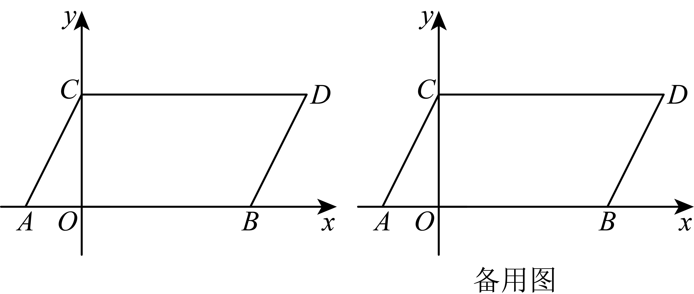

# Mathematics - 题目 3745

**ID**: e1320c82b55f4bca9486f4b045c75101
**年级**: Grade 7
**难度**: Medium-Hard
**题型**: Calculation

## 题目
综合与探究：如图，已知点 $A\left ({a,0}\right ),B\left ({b,0}\right )$ 满足 $\sqrt {(3a+b){^{2}}}+\left |{b-3}\right |=0$ ．将线段 $AB$ 先向上平移2个单位，再向右平移1个单位后得到线段 $CD$ ，并连接 $AC、BD$（1）点 $A$ 的坐标是_，点 $B$ 的坐标是_；​​​​​​​‌（2）点 $M$ 从 $O$ 点出发，以每秒1个单位的速度向上平移运动．设运动时间为 $t$ 秒，问：是否存在这样的 $t$ ，使得四边形 $OMDB$ 的面积等于9？若存在，请求出 $t$ 的值；若不存在，请说明理由；（3）在（2）的条件下，点 $M$ 从 $O$ 点出发的同时，点 $N$ 从点 $B$ 出发，以每秒2个单位的速度向左平移运动，设射线 $DN$ 交 $y$ 轴于点 $E$ ．设运动时间为 $t$ 秒，直接写出 $S{{}_{\mathrm{△}EMD}}-S{{}_{\mathrm{△}OEN}}$ 的值．

## 解答

1. （1）解：∵ $\sqrt {(3a+b){^{2}}}+\left |{b-3}\right |=0$ ， $\sqrt {(3a+b){^{2}}}\geqslant 0,\left |{b-3}\right |\geqslant 0$ ，
2. $\therefore \begin{cases}3a+b=0\\b-3=0\end{cases}$ ，解得 $\begin{cases}a=-1\\b=3\end{cases}$ ，
3. ∴点A和点 $B$ 的坐标分别为 $\left ({-1,0}\right )$ ； $\left ({3,0}\right )$ ，
4. 故答案为： $\left ({-1,0}\right )$ ； $\left ({3,0}\right )$ ；
5. （2）解：存在．
6. 过D作 $DH\bot OB$ 的延长线，垂足为H，如图所示：
7. 
8. ∵点A和点 $B$ 的坐标分别为 $\left ({-1,0}\right )$ ； $\left ({3,0}\right )$ ，
9. ∴ $AB=4$ ，
10. ∵将线段 $AB$ 先向上平移2个单位，再向右平移1个单位后得到线段 $CD$ ，
11. ∴点C和点D的坐标分别为 $\left ({0,2}\right )$ 和 $\left ({4,2}\right )$ ，
12. ∴ $CD=4，DH=2，OB=3$ ，
13. 设M点坐标为 $\left ({0,t}\right )$ ，连接 $MD、OD$ ，
14. ∴ $OM=t$ ，
15. ∵ $S{{}_{四边形OMDB}}=S{{}_{\mathrm{△}OBD}}+S{{}_{\mathrm{△}OMD}}=9$ ，
16. ∴ $\frac {1}{2}OB\cdot DH+\frac {1}{2}OM\cdot CD=9$ ，即 $\frac {1}{2}\times 3\times 2+\frac {1}{2}t\times 4=9$ ，解得 $t=3$ ，
17. ∴存在这样的 $t=3$ ，使得四边形 $OMDB$ 的面积等于9；
18. （3）解：不变．
19. 理由如下：
20. 当点N在线段 $OB$ 上时，如图所示，设运动时间为 $t$ 秒， $OM=t，ON=3-2t$ ，
21. 
22. 过D作 $DH\bot OB$ 的延长线，垂足为H，连接 $MD，OD$ ，
23. ∵ $S{{}_{\vartriangle EMD}}-S{{}_{\vartriangle OEN}}=S{{}_{四边形OMDN}}$ ， $S{{}_{四边形OMDN}}=S{{}_{\vartriangle OND}}+S{{}_{\vartriangle OMD}}$_{ }，
24. ∴ $S{{}_{\vartriangle EMD}}-S{{}_{\vartriangle OEN}}=S{{}_{\vartriangle OND}}+S{{}_{\vartriangle OMD}}$
25. ${\rm =}\frac {1}{2}ON\centerdot DH+\frac {1}{2}OM\centerdot CD$
26. ${\rm =}\frac {1}{2}\times \left ({3-2t}\right )\times 2+\frac {1}{2}t\times 4$
27. $=3-2t+2t$
28. $=3$ ，
29. 当点N运动到线段 $BO$ 的延长线上时，如图所示，设运动时间为 $t$ 秒， $OM=t，ON=2t-3$ ，连接 $OD$ ，
30. $S{{}_{\vartriangle EMD}}-S{{}_{\vartriangle OEN}}=S{{}_{\vartriangle EMD}}+S{{}_{\vartriangle OED}}-\left ({S{{}_{\vartriangle OEN}}+S{{}_{\vartriangle OED}}}\right )=S{{}_{\vartriangle OMD}}-S{{}_{\vartriangle OND}}$
31. $=\frac {1}{2}\times 4\cdot OM-\frac {1}{2}\times 2\cdot ON$
32. $=\frac {1}{2}\times 4t-\frac {1}{2}\times 2\left ({2t-3}\right )$
33. $=2t-\left ({2t-3}\right )=3$ ，
34. 综上可知， $S{{}_{\vartriangle EMD}}-S{{}_{\vartriangle OEN}}$ 的值为 $3$ ．

## 知识点

**中文**:
  - 几何变换——平移综合题
  - 绝对值非负性的应用

**English**:
  - Translation Comprehensive Problems
  - Applications of Non-negativity of Absolute Value

---
