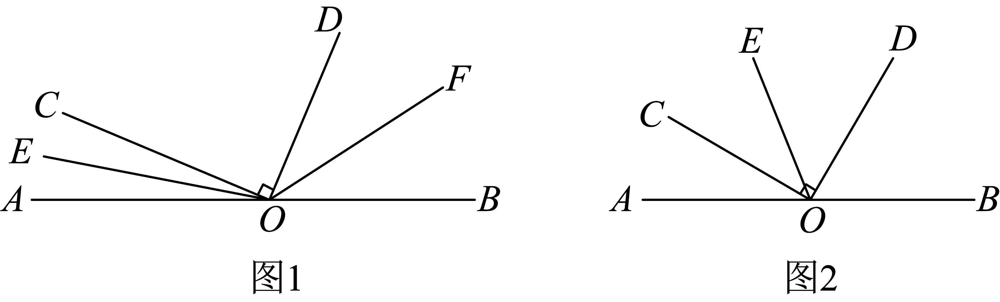

# Mathematics - 题目 3798

**ID**: e2ce7b61ca4e42c9a04602e0b323c22b
**年级**: Grade 7
**难度**: Medium-Hard
**题型**: Calculation

## 题目
点O为直线AB上一点，在直线AB同侧任作射线OC、OD，使得 ${\rm ∠COD=90°}$（1）如图1，过点O作射线OE，当OE恰好为 ${\rm ∠AOC}$ 的角平分线时，另作射线OF，使得OF平分 ${\rm ∠BOD}$ ，则 ${\rm ∠EOF}$ 的度数是度；​​​​​​​‌（2）如图2，过点O作射线OE，当OE恰好为 ${\rm ∠AOD}$ 的角平分线时，求出 ${\rm ∠BOD}$ 与 ${\rm ∠COE}$ 的数量关系；（3）过点O作射线OE，当OC恰好为 ${\rm ∠AOE}$ 的角平分线时，另作射线OF，使得OF平分 ${\rm ∠COD}$ ，若 ${\rm ∠EOC=3∠EOF}$ ，直接写出 ${\rm ∠AOE}$ 的度数

## 解答

1. 解：（1）如图：
2. 
3. ∵ ${\rm ∠COD=90°}$ ，
4. ∴ ${\rm ∠AOC+∠BOD=90°}$ ，
5. ∵OE平分 ${\rm ∠AOC，OF}$ 平分 ${\rm ∠BOD}$ ，
6. ∴ ${\rm ∠COE+∠DOF=}\frac {1}{2}(\angle AOC+\angle BOD)=\frac {1}{2}\times 90{}\degree =45{}\degree $ ，
7. ∴ ${\rm ∠EOF=∠COE+∠COD+∠DOF=45°+90°=135°}$ .
8. （2）∠BOD=2∠COE；
9. 理由如下：如图，
10. 
11. ∵ ${\rm ∠COD=90°}$ ．
12. ∴ ${\rm ∠BOD+∠AOC=90°}$ ，
13. ∵OE平分 ${\rm ∠AOD}$ ，
14. ∴ ${\rm ∠AOE=∠DOE=}\frac {1}{2}{\rm ∠AOD}$ ，
15. 又∵ ${\rm ∠BOD=180°}\mathbf{-}{\rm ∠AOD}$ ，
16. ∴ ${\rm ∠COE=∠AOE}\mathbf{-}{\rm ∠AOC}$
17. ${\rm =}\frac {1}{2}{\rm ∠AOD}$  $\mathbf{-}$ （90° $\mathbf{-}$ ∠BOD）
18. ${\rm =}\frac {1}{2}$ （180° $\mathbf{-}$ ∠BOD） $\mathbf{-}{\rm 90°+∠BOD}$
19. ${\rm =}\frac {1}{2}{\rm ∠BOD}$ ，
20. ∴ ${\rm ∠BOD=2∠COE}$ ；
21. （3）如图，
22. 
23. ∵OC为 ${\rm ∠AOE}$ 的角平分线，OF平分 ${\rm ∠COD}$ ，
24. ∴ ${\rm ∠AOC=∠COE，∠COF=∠DOF=45°}$ ，
25. ∵ ${\rm ∠EOC=3∠EOF}$ ，
26. 设 ${\rm ∠EOF=x}$ ，则 ${\rm ∠EOC=3x}$ ，
27. ∴ ${\rm ∠COF=4x}$ ，
28. ∴ ${\rm ∠AOE=2∠COE=6x，∠DOF=4x}$ ，
29. ∵ ${\rm ∠COD=90°}$ ，
30. ∴4x+4x=90°，
31. 解得：x=11.25°，
32. ∴ ${\rm ∠AOE=6×11.25°=67.5°}$ ．

## 知识点

**中文**:
  - 余角和补角
  - 角的运算
  - 角平分线

**English**:
  - Complementary and Supplementary Angles
  - Operations with Angles
  - Angle Bisector

---
