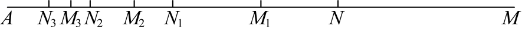

# Mathematics - 题目 3093

**ID**: e438526c7a7d4af4a4a9cbb092924431
**年级**: Grade 7
**难度**: Medium-Hard
**题型**: Calculation

## 题目
【实例】求值： $1+2+2{^{2}}+2{^{3}}+2{^{4}}\cdots \cdots +2{^{10}}$解：设 $P=1+2+2{^{2}}+2{^{3}}+2{^{4}}\cdots \cdots +2{^{10}}$ ①将等式两边同时乘2，得： $2P=2+2{^{2}}+2{^{3}}+2{^{4}}+2{^{5}}\cdots \cdots +2{^{11}}$ ②将②式减去①式，得： $2P-P=2{^{11}}-1$ ，即 $P=1+2+2{^{2}}+2{^{3}}+2{^{4}}\cdots \cdots +2{^{10}}=2{^{11}}-1$【运用】（1） $1+2+2{^{2}}+2{^{3}}+2{^{4}}\cdots \cdots +2{^{20}}=$﹔【拓展】（2）计算： $1+3+3{^{2}}+3{^{3}}+3{^{4}}+\cdots \cdots +3{^{10}}$ ；​​​​​​​‌【迁移】（3）如图，点 $M$ 在线段 $AN$ 的延长线上，且线段 $MN=20$ ，第一次操作：分别取线段 $AM$ 和 $AN$ 的中点 $M{{}_{1}}$ 、 $N{{}_{1}}$ ﹔第二次操作：分别取线段 $AM{{}_{1}}$ 和 $AN{{}_{1}}$ 的中点 $M{{}_{2}}$ 、 $N{{}_{2}}$ ；第三次操作：分别取线段 $AM{{}_{2}}$ 和 $AN{{}_{2}}$ 的中点 $M{{}_{3}}$ 、 $N{{}_{3}}$ ； $\ldots \ldots $ 连续这样操作 $10$ 次，则每次的两个中点所形成的所有线段之和 $M{{}_{1}}N{{}_{1}}+M{{}_{2}}N{{}_{2}}+M{{}_{3}}N{{}_{3}}+\cdots \cdots M{{}_{10}}N{{}_{10}}$ 的值为多少 $?$

## 解答

1. 解：（1）设 $P=1+2+2{^{2}}+2{^{3}}+2{^{4}}\cdots \cdots +2{^{20}}$ ①
2. 将等式①的两边同时乘以2得： $2P\mathrm{=}2+2{^{2}}+2{^{3}}+2{^{4}}\cdots \cdots +2{^{21}}$^{ }②
3. 将②式减去①式，得： $P=2{^{21}}-1$ ，
4. ∴ $1+2+2{^{2}}+2{^{3}}+2{^{4}}\cdots \cdots +2{^{20}}=2{^{21}}-1$ ．
5. 故答案为： $2{^{21}}-1$ ．
6. （2）设 $S=1+3+3{^{2}}+3{^{3}}+3{^{4}}+\cdots \cdots +3{^{10}}$ ①
7. 将等式两边同时乘3，得： $3S=3+3{^{2}}+3{^{3}}+3{^{4}}+\cdots \cdots +3{^{11}}$ ②
8. 将②式减去①式，得 $2S=3{^{11}}-1$
9. ∴ $S=\frac {3{^{11}}-1}{2}$ ，即 $1+3+3{^{2}}+3{^{3}}+3{^{4}}+\cdots \cdots +3{^{10}}=\frac {3{^{11}}-1}{2}$
10. （3）∵ $MN=20$ ， $M{{}_{1}}$ 、 $N{{}_{1}}$ 是线段 $AM$ 和 $AN$ 的中点，
11. ∴ $M{{}_{1}}N{{}_{1}}=AM{{}_{1}}-AN{{}_{1}}=\frac {1}{2}\left ({AM-AN}\right )=\frac {1}{2}MN=10$ ，
12. 同理可得 $M{{}_{2}}N{{}_{2}}=\frac {1}{2}M{{}_{1}}N{{}_{1}}=5$
13. ……
14. $M{{}_{10}}N{{}_{10}}=\frac {1}{2}M{{}_{9}}N{{}_{9}}$
15. ∴ $M{{}_{1}}N{{}_{1}}+M{{}_{2}}N{{}_{2}}+M{{}_{3}}N{{}_{3}}+\cdots \cdots M{{}_{10}}N{{}_{10}}=\frac {1}{2}\times 20+{\left({\frac {1}{2}}\right)^{2}}\times 20+\cdot \cdot \cdot +{\left({\frac {1}{2}}\right)^{10}}\times 20$
16. $=20\times \left [\frac {1}{2}+{\left({\frac {1}{2}}\right)^{2}}+\cdot \cdot \cdot +{\left({\frac {1}{2}}\right)^{10}}\right ]$
17. 设 $Q=20\times \left [\frac {1}{2}+{\left({\frac {1}{2}}\right)^{2}}+\cdot \cdot \cdot +{\left({\frac {1}{2}}\right)^{10}}\right ]$ ①
18. ∴ $\frac {1}{2}Q=20\times \left [{\left({\frac {1}{2}}\right)^{2}}+{\left({\frac {1}{2}}\right)^{3}}+\cdot \cdot \cdot +{\left({\frac {1}{2}}\right)^{11}}\right ]$ ②
19. 将①式减去②式，得 $\frac {1}{2}Q=20\times \left [\frac {1}{2}-{\left({\frac {1}{2}}\right)^{11}}\right ]$
20. ∴ $Q=20\times \left [1-{\left({\frac {1}{2}}\right)^{10}}\right ]=20-20\times {\left({\frac {1}{2}}\right)^{10}}=20-\frac {20}{1024}=\frac {5115}{256}$

## 知识点

**中文**:
  - 线段的中点
  - 规律型：数与式的变化类
  - 规律型：图形的变化类

**English**:
  - Midpoint of a Line Segment
  - Patterns: Number and Expression Variations
  - Patterns: Geometric Variations

---
