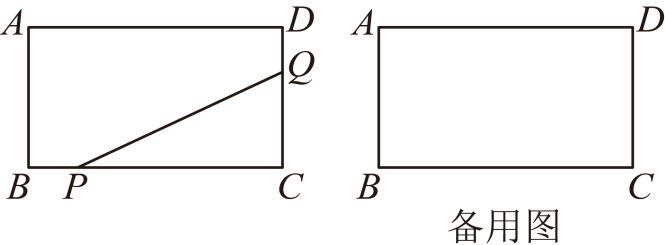

# Mathematics - 题目 488

**ID**: f250231b49b24937814cd8a2b91a3429
**年级**: Grade 7
**难度**: Medium-Hard
**题型**: Calculation

## 题目
如图， 在长方形 $ABCD$ 中，  $AB=10,BC=18.​​​​​​​‌$ 动点P从点B出发，以每秒2个单位长度的速度沿 $B\to C$ 的方向运动；同时动点Q从点C出发，以每秒5个单位长度的速度沿 $C\to D\to A$ 的路径运动，连结 $PQ$ ．当其中一个动点到达终点时，另一个动点也随之停止运动．设点Q的运动时间为t秒 ${\rm ．}\left ({t>0}\right )$（1）写出 $DQ$ 的长（用含t的代数式表示）．（2）当线段 $PQ$ 将长方形 $ABCD$ 分割后，所得图形中存在轴对称图形时，  $t=$ _．（3）若点Q到达点A后，以原速度的2倍返回到点D，同时点P以原速度继续向点C运动．在点Q的整个运动过程中：①当线段 $PQ$ 平分长方形 $ABCD$ 的周长时，求 $t$ 的值；②作点Q关于点D的中心对称点  $Q^{′},$ 直接写出．  $△PQQ^{′}$ 的面积是 $\mathrm{△}PCD$ 面积的  $\frac {2}{3}$ 时t的值．

## 解答

1. （1）解：∵四边形 $ABCD$ 是长方形， $AB=10,BC=18$ ，
2. ∴ $CD=AB=10,AD=BC=18$ ，
3. ∵动点P从点B出发，以每秒2个单位长度的速度沿 $B\to C$ 的方向运动；同时动点Q从点C出发，以每秒5个单位长度的速度沿 $C\to D\to A$ 的路径运动，
4. ∴点 $P$ 到达 $C$ 点的时间为： $18\div 2=9\left ({{\rm{s}}}\right )$ ，
5. 点 $Q$ 到达 $D$ 点的时间为： $10\div 5=2\left ({{\rm{s}}}\right )$ ，
6. 点 $Q$ 到达 $\mathrm{A}$ 点的时间为： $\left ({10+18}\right )\div 5=\frac {28}{5}\left ({{\rm{s}}}\right )$ ，
7. 当 $0<t\leqslant 2$ 时， $DQ=CD-CQ=10-5t$ ，
8. 当 $2<t\leqslant \frac {28}{5}$ 时， $DQ=CQ-CD=5t-10$ ，
9. ∴ $DQ=\begin{cases}10-5t\left ({0<t\leqslant 2}\right )\\5t-10\left ({2<t\leqslant \frac {28}{5}}\right )\end{cases}$ ；
10. （2）解：依题意可知，当线段 $PQ$ 将长方形 $ABCD$ 分割后，所得图形中存在轴对称图形，则 $PQ\bot BC$ ，如图：
11. 
12. ∴ $BP=AQ$ ，
13. ∴ $2t=\left ({10+18}\right )-5t$ ，
14. 解得： $t=4{\rm{s}}$ ，
15. 故答案为： $4{\rm{s}}$ ；
16. （3）解：①点Q到达点A后，以原速度的2倍返回到点D的时间为： $\frac {28}{5}+\frac {18}{10}=\frac {37}{5}\left ({{\rm{s}}}\right )$ ，
17. 长方形的周长为： $2\times \left ({18+10}\right )=56$ ，
18. 当 $PQ$ 平分周长时， $CP+CQ=\frac {56}{2}=28$ ，
19. 当 $0<t\leqslant \frac {28}{5}$ 时，
20. $18-2t+5t=28$ ，
21. 解得： $t=\frac {10}{3}$ ，
22. 当 $\frac {28}{5}<t\leqslant \frac {37}{5}$ 时，
23. $18-2t+10+\left [18-10\left ({t-\frac {28}{5}}\right )\right ]=28$ ，
24. 解得： $t=\frac {37}{6}$ ；
25. ②当 $0<t<2$ 时， $CP=18-2t$ ， $DQ^{′}=DQ=10-5t$ ，如图：
26. 
27. ∴ $QQ^{′}=20-10t$ ，
28. ∴ $S{{}_{\vartriangle PQQ^{′}}}=\frac {1}{2}QQ^{′}{\cdot }CP=\frac {1}{2}\times \left ({20-10t}\right )\times \left ({18-2t}\right )$ ，
29. $S{{}_{\vartriangle PCD}}=\frac {1}{2}CP\cdot CD=\frac {1}{2}\times \left ({18-2t}\right )\times 10$ ，
30. ∵ $△PQQ^{′}$ 的面积是 ${\rm △\mathit{PCD}}$ 面积的  $\frac {2}{3}$ ，
31. ∴ $\frac {1}{2}\times \left ({20-10t}\right )\times \left ({18-2t}\right )=\frac {2}{3}\left [\frac {1}{2}\times \left ({18-2t}\right )\times 10\right ]$ ，
32. 解得： $t=\frac {4}{3}$ ，
33. 当 $2<t\leqslant \frac {28}{5}$ 时， $CP=18-2t$ ， $DQ^{′}=DQ=5t-10$ ，如图：
34. 
35. ∴ $QQ^{′}=10t-20$ ，
36. ∴ $S{{}_{\vartriangle PQQ^{′}}}=\frac {1}{2}QQ^{′}{\cdot }CD=\frac {1}{2}\times \left ({10t-20}\right )\times 10$ ，
37. $S{{}_{\vartriangle PCD}}=\frac {1}{2}CP\cdot CD=\frac {1}{2}\times \left ({18-2t}\right )\times 10$ ，
38. ∵ $△PQQ^{′}$ 的面积是 $\mathrm{△}PCD$ 面积的  $\frac {2}{3}$ ，
39. ∴ $\frac {1}{2}\times \left ({10t-20}\right )\times 10=\frac {2}{3}\left [\frac {1}{2}\times \left ({18-2t}\right )\times 10\right ]$ ，
40. 解得： $t=\frac {48}{17}$ ，
41. 当 $\frac {28}{5}<t\leqslant \frac {37}{5}$ 时， $CP=18-2t$ ， $DQ^{′}=DQ=18-10\left ({t-\frac {28}{5}}\right )=74-10t$ ，如图：
42. 
43. ∴ $QQ^{′}=148-20t$ ，
44. ∴ $S{{}_{\vartriangle PQQ^{′}}}=\frac {1}{2}QQ^{′}{\cdot }CD=\frac {1}{2}\times \left ({148-20t}\right )\times 10$ ，
45. $S{{}_{\vartriangle PCD}}=\frac {1}{2}CP\cdot CD=\frac {1}{2}\times \left ({18-2t}\right )\times 10$ ，
46. ∵ $△PQQ^{′}$ 的面积是 $\mathrm{△}PCD$ 面积的  $\frac {2}{3}$ ，
47. ∴ $\frac {1}{2}\times \left ({148-20t}\right )\times 10=\frac {2}{3}\left [\frac {1}{2}\times \left ({18-2t}\right )\times 10\right ]$ ，
48. 解得： $t=\frac {51}{7}$ ，
49. 综上， $△PQQ^{′}$ 的面积是 $\mathrm{△}PCD$ 面积的  $\frac {2}{3}$ 时t的值为 $\frac {4}{3}$ 或 $\frac {48}{17}$ 或 $\frac {51}{7}$ ．

## 知识点

**中文**:
  - 中心对称的性质
  - 行程问题
  - 轴对称的性质

**English**:
  - Properties of Central Symmetry
  - Distance-Speed-Time Problems
  - Properties of Axial Symmetry

---
