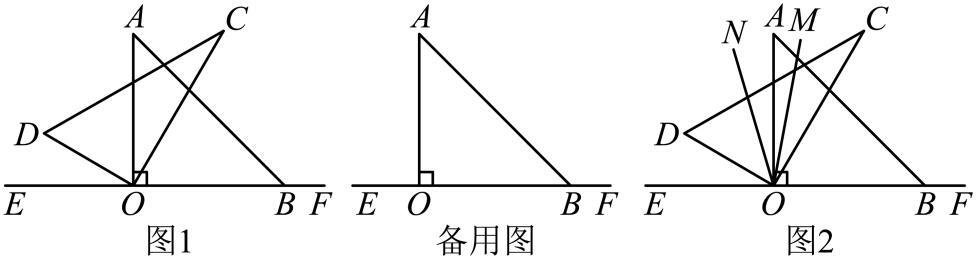

# Mathematics - 题目 2212

**ID**: f9c34983cc4e44acb9d26fd51d3174b6
**年级**: Grade 7
**难度**: Medium-Hard
**题型**: Calculation

## 题目
如图，O为直线 $EF$ 上一点，将一副直角三角尺的两个直角顶点叠合在O处，其中一个直角三角尺的另一顶点落在直线 $EF$ 上的B点．(1)如图1，若 $\angle AOC=30{}\degree $ ，求 $\angle DOB$ 的度数；​​​​​​​‌(2)将直角三角尺 $ODC$ 从图1的位置绕O点逆时针方向旋转 $a{}\degree \left ({0<a<90}\right )$ ，若 $\angle AOD=5\angle AOC$ ，求 $\angle DOB$ 的度数；(3)将直角三角尺 $ODC$ 从如图2的位置绕O点逆时针方向旋转一周，射线 $ON$ 在 $\angle AOD$ 内，射线 $OM$ 在 $∠AOC$ 内，且 $\angle AOD=n\angle AON$ ， $\angle AOC=n\angle AOM$ ，在转动过程中某个位置测得 $\angle MON=63{}\degree $ ，则 $n=$．

## 解答

1. （1）解：∵ $\angle AOC=30{}\degree $ ， $\angle AOB=\angle COD=90{}\degree $ ，
2. ∴ $\angle AOD=90{}\degree -30{}\degree =60{}\degree $ ，
3. ∴ $\angle BOD=\angle AOB+\angle AOD=90{}\degree +60{}\degree =150{}\degree $ ；
4. （2）解：∵ $\angle BOD=150{}\degree $ ，
5. ∴ $\angle DOE=30{}\degree $ ，
6. 如图，
7. 
8. 当 $\angle AOD=5\angle AOC$ 时，
9. ∴ $\angle AOD=90{}\degree \times \frac {5}{6}=75{}\degree $ ，
10. ∴ $\angle BOD=90{}\degree +75{}\degree =165{}\degree $ ，
11. 如图，
12. 
13. 当 $\angle AOD=5\angle AOC$ 时，
14. ∴ $\angle AOC=\frac {1}{4}\times 90{}\degree =22.5{}\degree $ ，
15. ∴ $\angle AOD=90{}\degree +22.5{}\degree =112.5{}\degree $ ，
16. ∴ $\angle BOD=360{}\degree -112.5{}\degree -90{}\degree =157.5{}\degree $ ；
17. 综上：当 $\angle AOD=4\angle AOC$ 时， $\angle BOD$ 为 $165{}\degree $ 或 $157.5{}\degree $ ．
18. （3）解：如图，
19. 
20. ∵ $\angle AOD=n\angle AON$ ， $\angle AOC=n\angle AOM$ ，
21. ∴ $\angle AOD+\angle AOC=n\left ({\angle AON+\angle AOM}\right )=n\angle MON=90{}\degree $ ，
22. ∵ $\angle MON=63{}\degree $ ，
23. ∴ $n=\frac {90}{63}=\frac {10}{7}$ ，
24. 如图，
25. 
26. ∵ $\angle AOD=n\angle AON$ ， $\angle AOC=n\angle AOM$ ，
27. ∴ $\angle AOD-\angle AOC=90{}\degree =n\left ({\angle AON-\angle AOM}\right )=n\angle MON$ ，
28. ∵ $\angle MON=63{}\degree $ ，
29. ∴ $n=\frac {90}{63}=\frac {10}{7}$ ，
30. 如图，
31. 
32. ∵ $\angle AOD=n\angle AON$ ， $\angle AOC=n\angle AOM$ ，
33. ∴ $\angle AOD+\angle AOC=360{}\degree -90{}\degree =270{}\degree $ ，
34. ∴ $n\left ({\angle AON+\angle AOM}\right )=270{}\degree $ ，即 $63{}\degree n=270{}\degree $ ，
35. 解得： $n=\frac {30}{7}$ ，
36. 如图，
37. 
38. ∵ $\angle AOD=n\angle AON$ ， $\angle AOC=n\angle AOM$ ，
39. ∴ $\angle AOC-\angle AOD=90{}\degree $ ，
40. ∴ $n\left ({\angle AOM-\angle AON}\right )=90{}\degree $ ，即 $63{}\degree n=90{}\degree $ ，
41. 解得： $n=\frac {10}{7}$ ，
42. 综上： $n$ 的值为 $\frac {10}{7}$ 或 $\frac {30}{7}$ ．

## 知识点

**中文**:
  - 角平分线
  - 角的运算

**English**:
  - Angle Bisector
  - Operations with Angles

---
