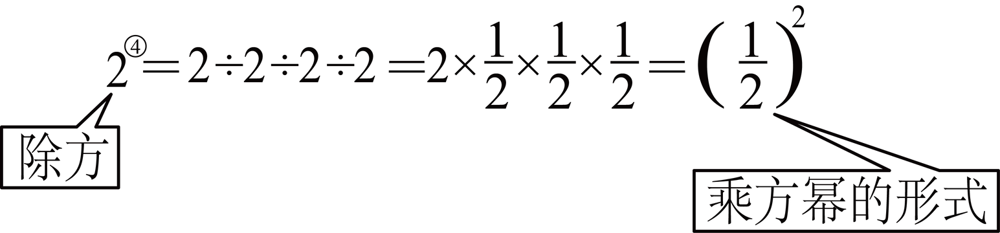
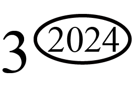
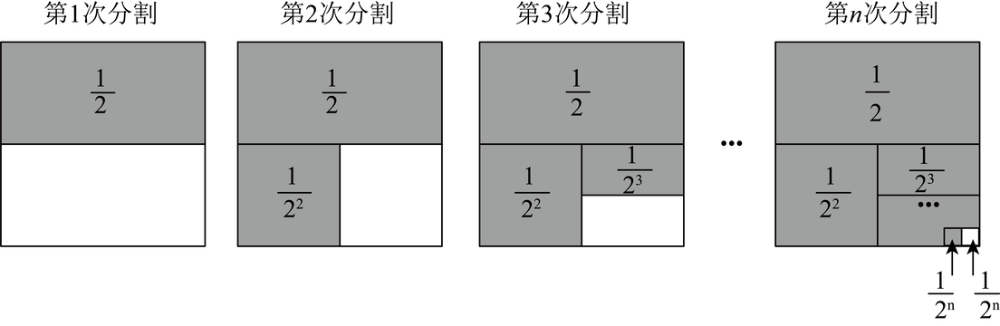

# Mathematics - 题目 1137

**ID**: fc3fffe191d04086966d271d81c325b5
**年级**: Grade 7
**难度**: Medium-Hard
**题型**: Calculation

## 题目
【概念学习】规定：求若干个相同的有理数(均不等 $0$ )的除法运算叫做除方，如 $2\div 2\div 2$ ，类比有理数的乘方，把 $2\div 2\div 2$ 记作 $2{^{③}}$ ，读作“ $2$ 的圈 $3$ 次方” $.​​​​​​​‌$ 一般地，把 $\underbrace{a\div a\div a\div \cdots \div a}_{n个a}$  $\left ({a\ne 0}\right )$ 记作 $a{^{\mathrm{ⓝ}}}$ ，读作“ $a$ 的圈 $n$ 次方”．【初步探究】（1）直接写出计算结果： $2{^{③}}=$ _；【深入思考】我们知道，有理数的除法运算可以转化为乘法运算，有理数的除方运算如何转化为乘方运算呢？（2）仿照上面的算式，将运算结果直接写成幂的形式： $3{^{④}}=$ _；（3）将一个非零有理数 $a$ 的圈 $n$ 次方写成幂的形式是_；（4）计算： $6{^{2}}\div (-\frac {1}{3}){^{④}}\times (-2){^{③}}$ ．【拓展延伸】求 $3{^{③}}+3{^{④}}+3{^{⑤}}+\cdots \cdots {\rm +}$的值．为解决上面的数学问题，我们可以运用数形结合的思想方法，通过不断地分割一个面积为 $1$ 的正方形，把数量关系和几何图形巧妙地结合起来．如计算 $\frac {1}{2}+\frac {1}{2{^{2}}}+\frac {1}{2{^{3}}}+\ldots \ldots +\frac {1}{2{^{{\rm{n}}}}}$ ．第 $1$ 次分割，把正方形的面积二等分，其中阴影部分的面积为 $\frac {1}{2}$ ；第 $2$ 次分割，把上次分割图中空白部分的面积继续二等分，阴影部分的面积之和为 $\frac {1}{2}+\frac {1}{2{^{2}}}$ ；第 $3$ 次分割，把上次分割图中空白部分的面积继续二等分，阴影部分的面积之和为 $\frac {1}{2}+\frac {1}{2{^{2}}}+\frac {1}{2{^{3}}}$ ；$\ldots $第 $n$ 次分割，把上次分割图中空白部分的面积最后二等分，所有阴影部分的面积之和为 $\frac {1}{2}+\frac {1}{2{^{2}}}+\frac {1}{2{^{3}}}+\ldots \ldots +\frac {1}{2{^{n}}}$ ，最后空白部分的面积是 $\frac {1}{2{^{n}}}$ ．根据第 $n$ 次分割图可得等式： $\frac {1}{2}+\frac {1}{2{^{2}}}+\frac {1}{2{^{3}}}+\ldots \ldots +\frac {1}{2{^{n}}}=1-\frac {1}{2{^{n}}}$ ．（5） $3{^{③}}+3{^{④}}+3{^{⑤}}+\cdots \cdots +$=_；(可以在面积为 $1$ 的正方形(备用图)上画图进行分析)

## 解答

1. 解：（1） $2{^{③}}$  $=2\div 2\div 2=2\times \frac {1}{2}\times \frac {1}{2}=\frac {1}{2}$ ，
2. 故答案为： $\frac {1}{2}$ ；
3. （2） $3{^{④}}$  $=3\div 3\div 3\div 3=3\times \frac {1}{3}\times \frac {1}{3}\times \frac {1}{3}={\left({\frac {1}{3}}\right)^{2}}$ ，
4. 故答案为： ${\left({\frac {1}{3}}\right)^{2}}$ ；
5. （3）解：∵ $a{^{ⓝ}}={\mathop {{\mathop {a\div a\div a\div \cdots \div a}\limits_{�}^{}}}\limits_{n个a}^{}}=a\times \frac {1}{a}\times {\mathop {{\mathop {\frac {1}{a}\times \cdots \times \frac {1}{a}}\limits_{�}^{}}}\limits_{n-2个\frac {1}{a}}^{}}={\left({\frac {1}{a}}\right)^{n-2}}$
6. ∴一个非零有理数a的圈n次方写成幂的形式是 ${\left({\frac {1}{a}}\right)^{n-2}}$ ，
7. 故答案为： ${\left({\frac {1}{a}}\right)^{n-2}}$ ；
8. （4）解： $6{^{2}}\div \left ({-\frac {1}{3}}\right ){^{④}}\times \left ({-2}\right ){^{③}}$
9. $=36\div \frac {1}{{\left({-\frac {1}{3}}\right)^{2}}}\times \frac {1}{\left ({-2}\right )}$
10. $=36\times \frac {1}{9}\times \left ({-\frac {1}{2}}\right )$
11. $=-2$ ；
12. （5）解：第1次分割，把正方形的面积三等分，其中阴影部分的面积为 $\frac {2}{3}$ ；
13. 第2次分割，把上次分割图中空白部分的面积继续三等分，阴影部分的面积之和为 $\frac {2}{3}+\frac {2}{3{^{2}}}$ ；
14. 第3次分割，把上次分割图中空白部分的面积继续三等分，阴影部分的面积之和为 $\frac {2}{3}+\frac {2}{3{^{2}}}+\frac {2}{3{^{3}}}$ ；
15. …
16. 第n次分割，把上次分割图中空白部分的面积最后三等分，所有阴影部分的面积之和为 $\frac {2}{3}+\frac {2}{3{^{2}}}+\frac {2}{3{^{3}}}+\ldots \ldots +\frac {2}{3{^{n}}}$ ，最后空白部分的面积是 $\frac {1}{3{^{n}}}$ ．
17. 如图所示：
18. 
19. 根据第n次分割图可得等式： $\frac {2}{3}+\frac {2}{3{^{2}}}+\frac {2}{3{^{3}}}+\ldots \ldots +\frac {2}{3{^{n}}}{\rm =}$  $1-\frac {1}{3{^{n}}}=\frac {3{^{n}}-1}{3{^{n}}}$ ．
20. 则 $\frac {1}{3}+\frac {1}{3{^{2}}}+\frac {1}{3{^{3}}}+\ldots \ldots +\frac {1}{3{^{n}}}=\frac {3{^{n}}-1}{2\times 3{^{n}}}$ ，
21. ∴ $3{^{③}}+3{^{④}}+3{^{⑤}}+\cdots \cdots +$$=\frac {1}{3}+\frac {1}{3{^{2}}}+\frac {1}{3{^{3}}}+\ldots \ldots +\frac {1}{3{^{2022}}}$
22. $=\frac {3{^{2022}}-1}{2\times 3{^{2022}}}$ ．

## 知识点

**中文**:
  - 有理数的乘方
  - 有理数的混合运算
  - 规律型：数与式的变化类

**English**:
  - Powers of Rational Numbers
  - Mixed Operations of Rational Numbers
  - Patterns: Number and Expression Variations

---
