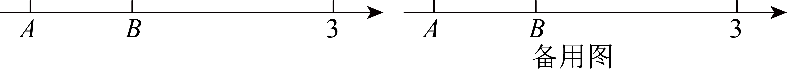

# Mathematics - 题目 517

**ID**: fd1d152815304cb7affd86bcb16f7d1b
**年级**: Grade 7
**难度**: Medium-Hard
**题型**: Calculation

## 题目
如图，数轴上A、B两点对应的数分别是a、b，其中 $\left |{a}\right |=3{\rm ，\mathit{b}}$ 为最大的负整数，且 $b>a$ ．将数轴折叠，点B与表示数3的点重合，点A与点C重合，点C对应的数是c．（1） $a=$ _， $b=$ _， $c=$ _；​​​​​​​‌（2）点A在数轴上以每秒3个单位长度的速度向右运动，求运动多少秒时点A与点B的距离为5？（3）若点B以每秒1个单位长度向左运动，同时，点A、C分别以每秒2个单位长度的速度和3个单位长度的速度向右运动，设运动时间为t秒．在运动过程中， $3BC-4AB$ 的值是否随着时间t的变化而改变？若变化，请说明理由；若不变，请求其值．

## 解答

1. （1）解：∵ $\left |{a}\right |=3$ ，
2. ∴ $a=3$ 或 $a=-3$ ；
3. ∵b为最大的负整数，
4. ∴ $b=-1$ ；
5. ∵ $b>a$ ，
6. ∴ $a=-3$ ；
7. ∵点B与表示数3的点重合，
8. ∴对称点为 $\frac {-1+3}{2}=1$ ，
9. ∵点A与点C重合， $a=-3$ ，
10. ∴点C对应的数是 $-3+2\times \left ({1+3}\right )=5$ ，
11. ∴ $c=5$ ；
12. 故答案为： $-3$ ， $-1{\rm ，5}$ ；
13. （2）解：设运动 $x$ 秒时点A与点B的距离为5，由题意可得：
14. $\left |{-3+3x-\left ({-1}\right )}\right |=5$ ，
15. 解得： $x=\frac {7}{3}$ 或 $-1$ ，
16. 由实际意义知 $x\geqslant 0$ ，
17. 所以 $x=\frac {7}{3}$ ，
18. 答：运动 $\frac {7}{3}$ 秒时点A与点B的距离为5；
19. （3）解：由题意得：点A、B、C运动后表示的数分别为： $-3+2t，-1-t，5+3t$ ，
20. 则 $BC=5+3t-\left ({-1-t}\right )=6+4t$ ； $AB=\left |{-3+2t-\left ({-1-t}\right )}\right |=\left |{3t-2}\right |$ ；
21. 所以 $3BC-4AB=3\left ({6+4t}\right )-4\left |{3t-2}\right |=18+12t-4\left |{3t-2}\right |$ ，
22. ①当 $3t-2\geqslant 0$ 时， $3BC-4AB=18+12t-4\left |{3t-2}\right |{\rm{=}}18+12t-12t{{+}}8{\rm{=}}26$ ，
23. 此时 $3BC-4AB$ 的值不变；
24. ②当 $3t-2＜0$ 时， $3BC-4AB=18+12t+4\left ({3t-2}\right )=24t+10$ ，
25. 此时 $3BC-4AB$ 的值随时间t的变化而变化；
26. 综上，当 $3t-2\geqslant 0$ 时， $3BC-4AB$ 的值不变，为26；当 $3t-2＜0$ 时， $3BC-4AB$ 的值随时间t的变化而变化．

## 知识点

**中文**:
  - 数轴上两点之间的距离
  - 用数轴上的点表示有理数
  - 数轴上的动点问题

**English**:
  - Distance Between Two Points on Number Line
  - Representing Rational Numbers on Number Line
  - Moving Point Problems on Number Line

---
