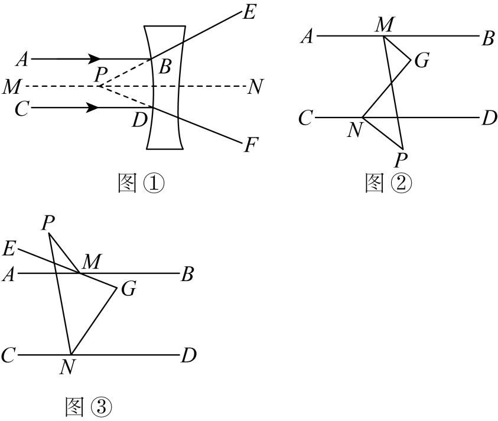

# Mathematics - 题目 3851

**ID**: fdd9db00d2f44204a6738c594f439d27
**年级**: Grade 7
**难度**: Medium-Hard
**题型**: Calculation

## 题目
综合与实践：【问题情境】光经过凹透镜后的折射实验探究．【实践操作】光明中学七年级3班好奇组在做光经过凹透镜的折射实验时发现：如图①，平行于主光轴 $MN$ 的光线 $AB$ 和 $CD$ 经过凹透镜的折射后，折射光线 $BE$ ， $DF$ 的反向延长线会交于主光轴 $MN$ 上一点 $P$ ．【实践探究】好奇组三位同学想弄清楚这两条平行线之间蕴含的数学知识，进行了以下探究：探究一：（1）在图①中， $∠BPD$ ， $∠ABP$ 和 $\angle CDP$ 三个角之间存在着怎样的数量关系，并说明理由．探究二：（2）在图②中，已知 $AB/\mskip-4mu/CD$ ，点 $M$ 、 $N$ 分别是 $AB$ 、 $CD$ 上的两点，点 $G$ 在 $AB$ 、 $CD$ 之间，连接 $MG$ 、 $NG$ ．若点 $P$ 是 $CD$ 下方一点， $MG$ 平分 $\angle BMP$ ， $ND$ 平分 $∠GNP$ ，已知 $∠BMG=30{}\degree $ ，求 $\angle MGN+\angle MPN$ 的度数．探究三：（3）在图③中，若点 $P$ 是 $AB$ 上方一点，连接 $PM$ 、 $PN$ ；​​​​​​​‌ $GM$ 的延长线 $ME$ 将 $\angle AMP$ 分为两部分，且 $3∠AME=2∠PME$ ， $∠CNP=2∠PNG$ ， $3\angle MPN+2\angle MGN=250{}\degree $ ，求 $\angle AMP$ 的度数．

## 解答

1. （1） $\angle BPD=\angle ABP+\angle CDP$ ，
2. 理由如下：过点 $P$ 作 $MN/\mskip-4mu/CD$ ，如图①，
3. $\because AB\parallel MN\parallel CD$ ，
4. $\therefore \angle BPN=\angle ABP$ ， $\angle DPN=\angle CDP$ ，
5. $\therefore \angle BPN+\angle DPN=\angle ABP+\angle CDP$ ，
6. $\therefore \angle BPD=\angle ABP+\angle CDP$ ．
7. （2）过点 $P$ 作 $PH/\mskip-4mu/CD$ ，如图②所示：
8. 
9. $\because MG$ 平分 $\angle BMP$ ， $∠BMG=30{}\degree $ ，
10. $\therefore \angle BMP=2\angle BMG=60{}\degree $ ，
11. $\because ND$ 平分 $∠GNP$ ，
12. $\therefore $ 设 $∠DNG=∠DNP=α$ ，
13. 由（1）得： $∠BMG+∠DNG=∠MGN$ ，
14. $\therefore 30{}\degree +α=\angle MGN$ ，
15. 即 $\angle MGN=30{}\degree +α$ ，
16. $\because AB\parallel CD$ ， $PH/\mskip-4mu/CD$ ，
17. $\therefore AB\mathrm{/\mskip-4mu/}CD\mathrm{/\mskip-4mu/}PH$ ，
18. $\therefore ∠NPH=∠DNP=α$ ， $\angle MPH=\angle BMP=60{}\degree $ ，
19. $\therefore \angle MPN=\angle MPH-\angle NPH=60{}\degree -α$ ，
20. $\therefore \angle MGN+\angle MPN=30{}\degree +α+60{^{\circ }}-α=90{}\degree $ ；
21. （3）过点 $P$ 作 $PQ/\mskip-4mu/AB$ ，如图③所示：
22. 
23. $\because 3∠AME=2∠PME$ ，
24. $\therefore $ 设 $∠PME=3α$ ，则 $∠AME=2α$ ，
25. $\therefore ∠AMP=∠PME+∠AME=5α$ ，
26. 由对顶角相等得： $∠BMG=AME=2α$ ，
27. 设 $∠PNG=β$ ，
28. $\therefore ∠CNP=2∠PNG=2β$ ，
29. $\therefore ∠CNG=∠CNP+∠PNG=2β+β=3β$ ，
30. $\therefore \angle DNG=180{}\degree -\angle CNG=180{}\degree -3β$ ，
31. 由（1）得： $∠BMG+∠DNG=∠MGN$ ，
32. $\therefore 2α+180{}\degree -3β=\angle MGN$ ，
33. 即 $\angle MGN=180{}\degree +2α-3β$ ，
34. $\because AB\parallel CD$ ， $PQ/\mskip-4mu/AB$ ，
35. $\therefore PQ/\mskip-4mu/AB/\mskip-4mu/CD$ ，
36. $\therefore ∠QPN=∠CNP=2β$ ， $∠QPM=∠AMP=5α$ ，
37. $\therefore ∠MPN=∠QPN-∠QPM=2β-5α$ ，
38. $\because 3\angle MPN+2\angle MGN=250{}\degree $ ，
39. $\therefore 3\left ({2β-5α}\right )+2\left ({180{}\degree +2α-3β}\right )=250{}\degree $ ，
40. 解得： $α=10\mathrm{°}$
41. $\therefore \angle AMP=5α=50{}\degree $ ．

## 知识点

**中文**:
  - 两直线平行内错角相等
  - 角平分线
  - 平行公理及推论

**English**:
  - Parallel Lines have Equal Alternate Interior Angles
  - Angle Bisector
  - Parallel Axiom

---
