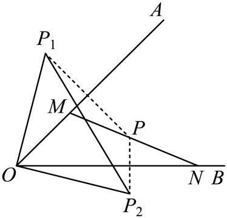

# Mathematics - 题目 161

**ID**: 29d7569c150d47a6b16af63b69dd96a2
**年级**: Grade 7
**难度**: Medium-Hard
**题型**: Fill-in-the-blank

## 题目
如图， $\angle AOB=45{}\degree $ ，点M、N分别在射线 $OA、OB$ 上， $MN=6$ ， $\vartriangle OMN$ 的面积为12，点P是直线 $MN$ 上的动点，点P关于 $OA$ 对称的点为 $P{{}_{1}}$ ，点P关于 $OB$ 对称的点为 $P{{}_{2}}$ ，当点P在直线 $NM$ 上运动时， $\angle P{{}_{1}}OP{{}_{2}}=$${}\degree $ ， $\vartriangle OP{{}_{1}}P{{}_{2}}$ 的面积最小值为．​​​​​​​‌

## 解答

1. 解：当点 $P$ 在线段 $MN$ 上，如图，连接 $OP$ ，过点 $O$ 作 $OH\bot MN$ 交 $NM$ 的延长线于 $H$ ，
2. 
3. ∵ $S{{}_{\vartriangle OMN}}=\frac {1}{2}MN\cdot OH=12$ ，且 $MN=6$ ，
4. ∴ $OH=4$ ，
5. ∵点 $P$ 关于 $OA$ 对称的点为 $P{{}_{1}}$ ，点 $P$ 关于 $OB$ 对称的点为 $P{{}_{2}}$ ，
6. ∴ $\angle AOP=\angle AOP{{}_{1}}$ ， $\angle BOP=\angle BOP{{}_{2}}$ ， $OP{{}_{1}}=OP=OP{{}_{2}}$ ，
7. ∵ $\angle AOB=45{}\degree $ ，
8. ∴ $\angle P{{}_{1}}OP{{}_{2}}=2\left ({\angle AOP+\angle BOP}\right )=2\angle AOB=90{}\degree $ ，
9. ∴ $\vartriangle OP{{}_{1}}P{{}_{2}}$ 的面积为 $\frac {1}{2}OP{{}_{1}}\cdot OP{{}_{2}}=\frac {1}{2}OP{^{2}}$ ，
10. 由垂线段最短可知，当点 $P$ 与点 $H$ 重合时， $OP$ 取得最小值，最小值为 $OH=4$ ，
11. ∴ $\vartriangle OP{{}_{1}}P{{}_{2}}$ 的面积的最小值为 $\frac {1}{2}\times 4{^{2}}=8$ ，
12. 当点 $P$ 在点 $M$ 的左侧时，如图：连接 $OP$ ，过点 $O$ 作 $OH\bot MN$ 交 $NM$ 的延长线于 $H$ ，
13. 
14. 同法可得： $OH=4$ ，
15. ∵点 $P$ 关于 $OA$ 对称的点为 $P{{}_{1}}$ ，点 $P$ 关于 $OB$ 对称的点为 $P{{}_{2}}$ ，
16. ∴ $\angle AOP=\angle AOP{{}_{1}}$ ， $\angle BOP=\angle BOP{{}_{2}}$ ， $OP{{}_{1}}=OP=OP{{}_{2}}$ ，
17. ∵ $\angle AOB=45{}\degree $ ，
18. ∴ $\angle P{{}_{1}}OP{{}_{2}}=2\left ({\angle BOP-\angle AOP}\right )=2\angle AOB=90{}\degree $ ，
19. ∴ $\vartriangle OP{{}_{1}}P{{}_{2}}$ 的面积为 $\frac {1}{2}OP{{}_{1}}\cdot OP{{}_{2}}=\frac {1}{2}OP{^{2}}$ ，
20. 由垂线段最短可知，当点 $P$ 与点 $H$ 重合时， $OP$ 取得最小值，最小值为 $OH=4$ ，
21. ∴ $\vartriangle OP{{}_{1}}P{{}_{2}}$ 的面积的最小值为 $\frac {1}{2}\times 4{^{2}}=8$ ，
22. 当点 $P$ 在点 $N$ 的右侧时，如图：连接 $OP$ ，过点 $O$ 作 $OH\bot MN$ 交 $NM$ 的延长线于 $H$ ，
23. 
24. 同法可得： $\angle P{{}_{1}}OP{{}_{2}}=2\left ({\angle AOP-\angle BOP}\right )=2\angle AOB=90{}\degree $ ，
25. $\vartriangle OP{{}_{1}}P{{}_{2}}$ 的面积的最小值为 $\frac {1}{2}\times 4{^{2}}=8$ ，
26. 综上： $\angle P{{}_{1}}OP{{}_{2}}=90{}\degree $ ， $\vartriangle OP{{}_{1}}P{{}_{2}}$ 的面积的最小值为 $8$ .

## 知识点

**中文**:
  - 垂线段最短
  - 轴对称的性质

**English**:
  - Shortest Perpendicular Segment
  - Properties of Axial Symmetry

---
