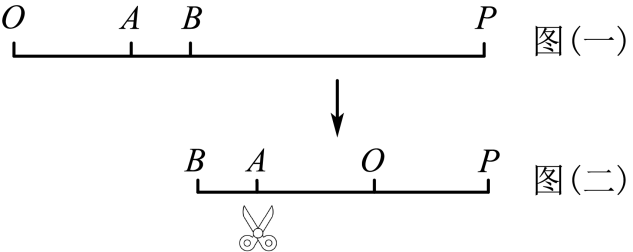

# Mathematics - 题目 3261

**ID**: 5e43d2b0e4514bafa6866d04a0a57bf8
**年级**: Grade 7
**难度**: Medium-Hard
**题型**: Fill-in-the-blank

## 题目
如图（一）， $OP$ 为一条拉直的细线， $A、B$ 两点在 $OP$ 上，且 $OA:AP=1:3$ ， $OB:BP=3:5$ ．若先固定 $B$ 点，将 $OB$ 折向 $BP$ ，使得 $OB$ 重叠在 $BP$ 上，如图（二），再从图（二）的A点及与A点重叠处一起剪开，使得细线分成三段，则此三段细线由小到大的长度比为．​​​​​​​‌

## 解答

1. 设 $OP$ 的长度为 $8a$ ，
2. ∵ $OA:AP=1:3$ ， $OB:BP=3:5$
3. ∴ $OA=2a$ ， $AP=6a$ ， $OB=3a$ ， $BP=5a$ ，
4. ∴ $AB=a$ ，
5. ∵再从图（二）的A点及与A点重叠处一起剪开，使得细线分成三段，
6. ∴剪开后这三段的长度分别是：
7. $OA$ 的长度，即 $2a$ ；
8. $AB$ 的长度的2倍，即 $2a$ ；
9. 图（二）中 $AP$ 的长度，即 $4a$ ，
10. ∴此三段细线由小到大的长度比为： $2a:2a:4a=1:1:2$ ．
11. 故此题答案为： $1:1:2$ ．

## 知识点

**中文**:
  - 比较线段的长短

**English**:
  - Comparing Line Segments

---
