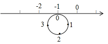

# Mathematics - 题目 3260

**ID**: 8b6cee3760424cadb1c71e63f75692a3
**年级**: Grade 7
**难度**: Medium-Hard
**题型**: Fill-in-the-blank

## 题目
如图，数轴上相邻两个整数之间的距离为1个单位，圆的周长为4个单位长，在圆的4等分点处分别标上0、1、2、3．先让圆周上表示数字0的点与数轴上表示-2的点重合，再将数轴右半轴按顺时针方向环绕在该圆上（如：圆周上表示数字1的点与数轴上表示-1的点重合…），则数轴上表示2020的点与圆周上表示数字的点重合．​​​​​​​‌

## 解答

1. 根据圆的周长是4，每4个单位为一个循环组依次循环，
2. ∵从-2到2020共2022个单位，
3. ∴ $2022\div 4=505\cdots 2$ ，
4. ∴数轴上表示2020的点与圆周上表示数字2的点重合；
5. 故答案是2．

## 知识点

**中文**:
  - 数轴上的动点问题

**English**:
  - Moving Point Problems on Number Line

---
