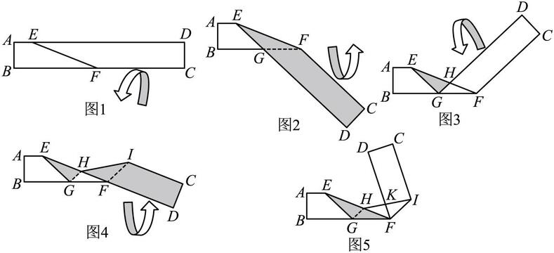

# Mathematics - 题目 2901

**ID**: aed1c8f8b7d94b6aa31e24665f158f74
**年级**: Grade 7
**难度**: Medium-Hard
**题型**: Fill-in-the-blank

## 题目
如图1，在长方形纸片 $ABCD$ 中，线段 $EF$ 交 $AD$ 于点E、交 $BC$ 于点F，设 $\angle DEF=α$ ， $\left ({0{}\degree <α<40{}\degree }\right )$（1）将长方形纸片 $ABCD$ 沿直线 $EF$ 折叠成图2，若 $α=25{}\degree $ ，则 $∠BFC$ 的度数为．（2）再沿折痕 $GF$ 折叠成图3，沿折痕 $HI$ 折叠成图 ${\rm 4，}HD$ 与 $HF$ 重合，沿折痕 $FI$ 折叠成图5，则 $\angle DKH$ 的度数为（用 ${\rm \mathit{α}}$ 表示）．（说明：各图中阴影部分为纸片的背面，箭头所指为翻折方向）​​​​​​​‌

## 解答

1. 解：（1）根据折叠可知： $\angle DEF=\angle GEF=α=25{}\degree $ ，
2. ∴ $\angle AEG=180{}\degree -25{}\degree -25{}\degree =130{}\degree $ ，
3. ∵ $AE{\rm{/\mskip-4mu/}}BF$ ，
4. ∴ $\angle BGD=\angle AEG=130{}\degree $ ，
5. ∵ $CF\mathrm{/\mskip-4mu/}DG$ ，
6. ∴ $\angle BFC=\angle BGD=130{}\degree $ .
7. （2）如图2，根据折叠可知： $\angle GEF=\angle MEF=α$ ，
8. 
9. ∵ $AE{\rm{/\mskip-4mu/}}BF$ ，
10. ∴ $\angle BGE=\angle GEM=\angle MEF+\angle GEF=2α$ ， $\angle GFE=\angle MEF=α$ ，
11. ∴ $\angle DGF=\angle BGE=2α$ ，
12. 如图3，根据折叠可知： $\angle HGF=\angle DGF=2α$ ，
13. 
14. ∵ $\angle DHF$ 为 $△GHF$ 的外角，
15. ∴ $\angle DHF=\angle HGF+\angle GFE=3α$ ，
16. 如图4，延长 $GH$ ， $FI$ ， $FI$ ，
17. 
18. 根据折叠可知： $\angle D^{′}HI=\angle FHI=\frac {1}{2}\angle DHF=\frac {3}{2}α$ ， $\angle CIP=\angle C^{′}IP$ ，
19. ∵ $HD^{′}{{\rm{/\mskip-4mu/}}}FI$ ，
20. ∴ $\angle C^{′}IP=\angle D^{′}HI=\frac {3}{2}α$ ， $\angle HIF=\angle D^{′}HI=\frac {3}{2}α$ ，
21. ∴ $\angle CIC^{′}=2\angle C^{′}IP=3α$ ，
22. 如图5，根据折叠可知： $\angle CIC^{′}=\angle C^{′′}IC^{′}=3α$ ，
23. 
24. ∴ $\angle CIK=180{}\degree -\angle CIC^{′}-\angle HIF=180{}\degree -3a-\frac {3}{2}α=180{}\degree -\frac {9}{2}α$ ，
25. ∵ $FD{\rm{/\mskip-4mu/}}CI$ ，
26. ∴ $\angle DKH=\angle CIK=180{}\degree -\frac {9}{2}α$ ．

## 知识点

**中文**:
  - 平行线性质的应用
  - 折叠问题

**English**:
  - Applications of Properties
  - Folding Problems

---
