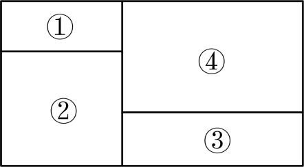

# Mathematics - 题目 728

**ID**: 1ee2385f12f0409a9bf9e0971b0b2fbc
**年级**: Grade 7
**难度**: Medium-Hard
**题型**: Multiple-choice

## 题目
如图，一个长方形被分成4部分，其中②号是正方形，③号与④号组成的图形是正方形，若①号与③号图形的周长已知，则下列条件中不能求出大长方形面积的是（      ）​​​​​​​‌

## 解答

1. 解：设①的长为 $a$ ，宽为 $b$ ，周长和为 $m$ ；③的宽为 $x$ ，长为 $y$ ，周长和为 $n$ ；其中 $m$ ， $n$ 为已知的常数，
2. $\therefore a+b=\frac {1}{2}m$ ，
3. $x+y=\frac {1}{2}n$ ，
4. $\because $ ②号是正方形，③号与④号组成的图形是正方形，
5. $\therefore $  $y=a+b=\frac {1}{2}m$ ，
6. $x=\frac {1}{2}n-\frac {1}{2}m$ ，
7. A.设①与②的周长之和为 $p$ （ $p$ 为已知的常数），则有 $2\left ({a+b}\right )+4a=p$ ，
8. 整理得， $3a+b=\frac {1}{2}p$ ， $a+b=\frac {1}{2}m$ ，
9. 解得 $a=\frac {1}{4}p-\frac {1}{4}m$ ， $b=\frac {3}{4}m-\frac {1}{4}p$ ，
10. $\therefore $ 大长方形面积为 $y\left ({a+y}\right )=\frac {1}{2}m\left ({\frac {1}{4}p-\frac {1}{4}m+\frac {1}{2}m}\right )$  $=\frac {1}{2}m\left ({\frac {1}{4}p+\frac {1}{4}m}\right )$ 是常数，
11. $\therefore $ 大长方形面积能求出，故不符合题意；
12. B.设②与③的面积之和为 $q$ （ $q$ 为已知的常数），
13. 则有 $a{^{2}}+xy=q$ ，
14. $\therefore a=\sqrt {q-\frac {1}{2}m\left ({\frac {1}{2}m-\frac {1}{2}n}\right )}$ ，
15. $\therefore $ 大长方形面积为 $y\left ({a+y}\right )=\frac {1}{2}m\left ({\sqrt {q-\frac {1}{2}m\left ({\frac {1}{2}m-\frac {1}{2}n}\right )}+\frac {1}{2}m}\right )$ 是常数，
16. $\therefore $ 大长方形面积能求出，故不符合题意；
17. C.设④与②的周长之差为 $k$ （ $k$ 为已知的常数），
18. $\therefore 2\left ({y+y-x}\right )-4a=k$ ，
19. $\therefore 2\left ({m-\frac {1}{2}m+\frac {1}{2}n}\right )-4a=k$ ，
20. 解得， $a=\frac {1}{4}\left ({m+n-k}\right )$ ，
21. $\therefore $ 大长方形面积为 $y\left ({a+y}\right )=\frac {1}{2}m\left ({\frac {1}{4}n-\frac {1}{4}k+\frac {3}{4}m}\right )$ 是常数，
22. $\therefore $ 大长方形面积能求出，故不符合题意；
23. D.设④与③的面积之差为 $s$ （ $s$ 为已知的常数），
24. $\therefore $  $y\left ({y-x}\right )-xy=s$ ，
25. $\therefore $  $y{^{2}}-2xy=s$ ，
26. 无法求出 $a$ ，
27. $\therefore $ 大长方形面积为 $y\left ({a+y}\right )$ 无法求出，故符合题意.
28. 故选D．

## 知识点

**中文**:
  - 整式的应用

**English**:
  - Applications of Polynomials

---
