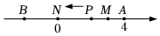

# Mathematics - 题目 28

**ID**: 5cf470f68d3f49c0a68e0e7ad52f5dd3
**年级**: Grade 7
**难度**: Medium-Hard
**题型**: Multiple-choice

## 题目
如图，已知A，B（B在A的左侧）是数轴上的两点，点A对应的数为4，且 $AB=6$ ，动点P从点A出发，以每秒2个单位长度的速度沿数轴向左运动，在点P的运动过程中，M，N始终为AP，BP的中点，设运动时间为 $t\left ({t>0}\right )$ 秒，则下列结论中正确的有（      ）①B对应的数是2；​​​​​​​‌②点P到达点B时， $t=3$ ；③ $BP=2$ 时， $t=2$ ；④在点P的运动过程中，线段MN的长度不变．

## 解答

1. 解：设点B对应的数是x，
2. ∵点A对应的数为4，且 $AB=6$  ，
3. ∴ $4-x=6$  ，
4. ∴ $x=-2$  ，
5. ∴点B对应的数是−2，故①错误；
6. 由题意得：
7. 6÷2=3（秒），
8. ∴点P到达点B时，t=3，故②正确；
9. 分两种情况：
10. 当点P在点B的右侧，
11. ∵AB=6，BP=2，
12. ∴ $AP=AB-BP=6-2=4$ ，
13. ∴4÷2=2（秒），
14. ∴BP=2时，t=2，
15. 当点P在点B的左侧，
16. ∵AB=6，BP=2，
17. ∴ $AP=AB+BP=6+2=8$ ，
18. ∴8÷2=4（秒），
19. ∴BP=2时，t=4，
20. 综上所述，BP=2时，t=2或4，故③错误；
21. 分两种情况：
22. 当点P在点B的右侧，
23. ∵M，N分别为AP，BP的中点，
24. ∴ $MP=\frac {1}{2}AP$ ， $NP=\frac {1}{2}BP$ ，
25. ∴ $MN=MP+NP=\frac {1}{2}AP+\frac {1}{2}BP=\frac {1}{2}\left ({AP+BP}\right )=\frac {1}{2}AB=3$ ，
26. 当点P在点B的左侧，
27. ∵M，N分别为AP，BP的中点，
28. $MP=\frac {1}{2}AP$ ， $NP=\frac {1}{2}BP$ ，
29. ∴ $MN=MP-NP=\frac {1}{2}AP-\frac {1}{2}BP=\frac {1}{2}\left ({AP-BP}\right )=\frac {1}{2}AB=3$ ，
30. ∴在点P的运动过程中，线段MN的长度不变，故④正确．
31. 所以，上列结论中正确的是②④．
32. 故此题答案为D．

## 知识点

**中文**:
  - 数轴上的动点问题

**English**:
  - Moving Point Problems on Number Line

---
