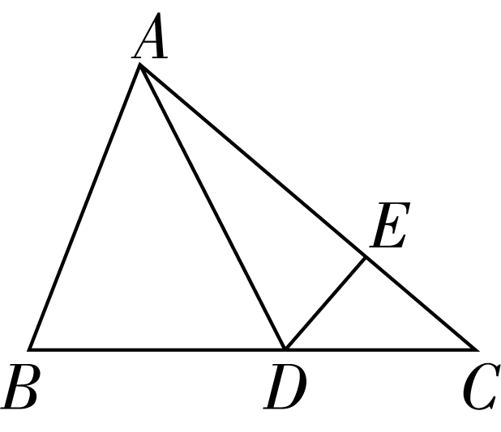

# Mathematics - 题目 2972

**ID**: 3468e5c8d79e44129a8ef947e9ce796e
**年级**: Grade 7
**难度**: Medium-Hard
**题型**: 刷提升

## 题目
如图，在△ABC中，AC＝BC，点D在BC边上，∠BAD＋∠C＝90°，点E在AC边上，∠AED＝2∠BAD，若BD＝16，CE＝7，则DE的长为．​​​​​​​‌

## 解答

1. 设∠C＝2α.因为∠BAD＋∠C＝90°，所以∠BAD＝90°－2α.因为AC＝BC，所以∠B＝∠BAC＝ $\frac{180°-2\alpha }{2}$ ＝90°－α，所以∠CAD＝α.如图，作∠ADF＝∠DAE＝α，DF交AE于点F，所以∠DFE＝2α，AF＝DF.因为∠AED＝2∠BAD＝180°－4α，所以∠EDF＝2α，所以∠EFD＝∠EDF＝∠C，所以EF＝DE，DF＝CD，所以AF＝CD，所以CF＝BD＝16.因为CE＝7，所以DE＝EF＝CF－CE＝9.
2. 
3. 【关键点拨】
4. 在初中几何类题型中遇到求边长的最大值、最小值，要首先想到用三角形的三边关系这一知识，通过添加辅助线构建三角形．本题即以CD为边作等边△DCE，连接AE.利用全等三角形的性质得到BD＝AE，再根据三角形的三边关系求解．

## 知识点

**中文**:
  - 等腰三角形的性质

**English**:
  - Properties of Isosceles Triangles

---
