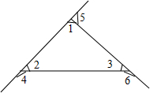

# Mathematics - 题目 1905

**ID**: 5bda95442e214e3ea41b3603a8d18f8b
**年级**: Grade 7
**难度**: Medium
**题型**: Multiple-choice

## 题目
如图所示，有下列五种说法：①∠1和∠4是同位角；​​​​​​​‌②∠3和∠5是内错角；③∠2和∠6旁内角；④∠5和∠2是同位角；⑤<1和∠3是同旁内角；其中正确的是（      ）

## 解答

1. 如图，
2. 
3. ①∠1和∠4是直线AC和直线BC被直线AB截得的同位角，所以①正确；
4. ②∠3和∠5是直线BC和直线AB被直线AC截得的内错角，所以②正确；
5. ③∠2和∠6是直线AB和直线AC被直线CB截得的内错角，所以③错误；
6. ④∠5和∠2是直线AC和直线BC被直线AB截得的同位角，所以④正确；
7. ⑤∠1和∠3是直线BC和直线AB被直线AC截得的同旁内角，所以⑤正确.
8. 故答案选D.
9. 点睛：
10. （1）准确识别同位角、内错角、同旁内角的关键，是弄清两角是由哪两条直线被哪条直线截得，这其中的关键是辨别出截线，在截线的两旁的是内错角，在截线的同旁的为同位角或同旁内角；
11. （2）辨别截线方法：先找出两角的边所在直线，公共直线即是截线.

## 知识点

**中文**:
  - 同位角、内错角、同旁内角

**English**:
  - Corresponding/Alternate/Consecutive Angles

---
