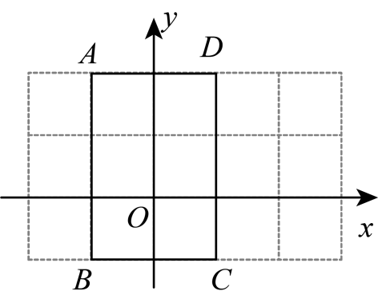

# Mathematics - 题目 3782

**ID**: e7c6811956e340bea2a7b4cdce1e7f68
**年级**: Grade 7
**难度**: Medium
**题型**: Multiple-choice

## 题目
如图，平面直角坐标系中，长方形 $ABCD$ 的四个顶点坐标分别为 $A\left ({-1,2}\right )$ ， $B\left ({-1,-1}\right )$ ， $C\left ({1,-1}\right )$ ， $D\left ({1,2}\right )$ ，点P从点A出发，沿长方形的边顺时针运动，速度为每秒2个长度单位，点Q从点A出发，沿长方形的边逆时针运动，速度为每秒3个长度单位，记P，Q在长方形边上第1次相遇时的点为 $M{{}_{1}}$ ，第二次相遇时的点为 $M{{}_{2}}$ ，第三次相遇时的点为 $M{{}_{3}}$ ，……，则点 $M{{}_{2023}}$ 的坐标为（      ）​​​​​​​‌

## 解答

1. 解：长方形 $ABCD$ 的周长为 $\left ({3+2}\right )\times 2=10$ ，
2. 设经过t秒P，Q第一次相遇，则P点走的路程为 $2t{\rm ，\mathit{Q}}$ 点走的路程为 $3t$ ，
3. 根据题意得 $2t+3t=10$ ，
4. 解得 $t=2$ ，
5. ∴当 $t=2$ 时，P、Q第一次相遇，此时相遇点 $M{{}_{1}}$ 坐标为 $\left ({1,0}\right )$ ，
6. 当 $t=4$ 时，P、Q第二次相遇，此时相遇点 $M{{}_{2}}$ 坐标为 $\left ({-1,0}\right )$ ，
7. 当 $t=6$ 时，P、Q第三次相遇，此时相遇点 $M{{}_{3}}$ 坐标为 $\left ({1,2}\right )$ ，
8. 当 $t=8$ 时，P、Q第四次相遇，此时相遇点 $M{{}_{4}}$ 坐标为 $\left ({0,-1}\right )$ ，
9. 当 $t=10$ 时，P、Q第五次相遇，此时相遇点 $M{{}_{5}}$ 坐标为 $\left ({-1,2}\right )$ ，
10. 当 $t=12$ 时，P、Q第六次相遇，此时相遇点 $M{{}_{6}}$ 坐标为 $\left ({1,0}\right )$ ，
11. ∴五次相遇一循环，
12. ∵ $2023\div 5=404\cdots \cdots 3$ ，
13. ∴ $M{{}_{2023}}$ 的坐标为 $\left ({1,2}\right )$ ．
14. 故选B．

## 知识点

**中文**:
  - 点的坐标
  - 规律型：数与式的变化类

**English**:
  - Coordinates of Points
  - Patterns: Number and Expression Variations

---
