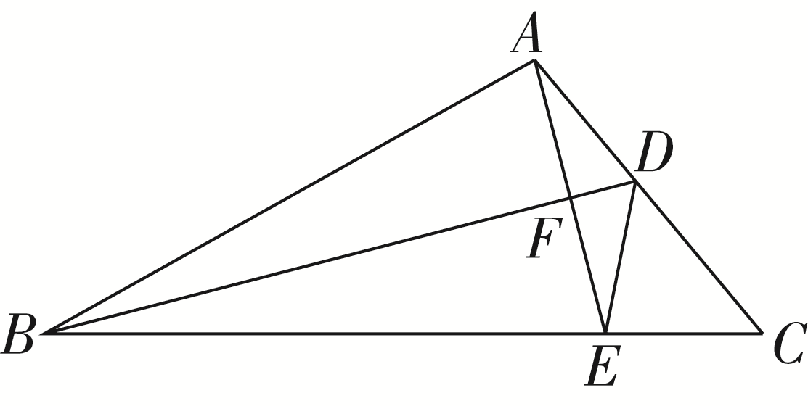

# Mathematics - 题目 3686

**ID**: cca69bbbc91f4aa398e977bc7a83552a
**年级**: Grade 7
**难度**: Medium
**题型**: 刷提升

## 题目
如图，在△ABC中，点E是BC边上的一点，连接AE，BD垂直平分AE，垂足为F，交AC于点D，连接DE.​​​​​​​‌(1)若△ABC的周长为18，△DEC的周长为6，求AB的长．(2)若∠ABC＝30°，∠C＝45°，求∠CDE的度数．

## 解答

1. (1)因为BD是线段AE的垂直平分线，
2. 所以AB＝BE，AD＝DE.
3. 因为△ABC的周长为18，△DEC的周长为6，
4. 所以AB＋BE＋EC＋CD＋AD＝18，CD＋EC＋DE＝CD＋CE＋AD＝6，
5. 所以AB＋BE＝18－6＝12，所以AB＝6.
6. (2)因为∠ABC＝30°，∠C＝45°，
7. 所以∠BAC＝180°－30°－45°＝105°.
8. 在△BAD和△BED中， $\left\{\hspace{-0.5em}\begin{array}{l}BA=BE,\\BD=BD,\\DA=DE,\end{array}\hspace{-0.5em}.\right.$
9. 所以△BAD≌△BED(SSS)，
10. 所以∠BED＝∠BAC＝105°，
11. 所以∠ADE＝360°－∠ABC－∠BAC－∠BED＝120°，
12. 所以∠CDE＝180°－∠ADE＝180°－120°＝60°.

## 知识点

**中文**:
  - 线段垂直平分线的性质

**English**:
  - Properties of Perpendicular Bisectors

---
