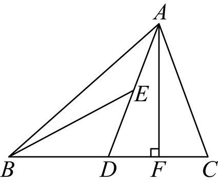

# Mathematics - 题目 1450

**ID**: 097ffa2a5a174f739622d934a1a969c0
**年级**: Grade 8
**难度**: Easy
**题型**: Calculation

## 题目
如图，在 $\vartriangle ABC$ 中， $AD$ 是 $BC$ 边上的中线， $AF$ 是 $BC$ 边上的高，点 $E$ 为 $AD$ 的中点．（1）若 $\angle ABE=13{}\degree $ ， $\angle BAD=29{}\degree $ ，求 $\angle BED$ 的度数．（2）若 $\vartriangle BDE$ 的面积为 $10$ ， $CD=5$ ，求 $AF$ 的长．​​​​​​​‌

## 解答

1. （1）解：∵ $\angle ABE=13{}\degree $ ， $\angle BAD=29{}\degree $ ，
2. ∴ $\angle BED=\angle ABE+\angle BAD=13{}\degree +29{}\degree =42{}\degree $ ；
3. （2）解：∵点E为 $AD$ 的中点， $\vartriangle BDE$ 的面积为10，
4. ∴ $S{{}_{\vartriangle }}{{}_{ABE}}=S{{}_{\vartriangle }}{{}_{BDE}}=10$ ，则 $S{{}_{\vartriangle }}{{}_{ABD}}=S{{}_{\vartriangle }}{{}_{ABE}}+S{{}_{\vartriangle }}{{}_{BDE}}=20$ ，
5. ∵ $AD$ 是 $BC$ 边上的中线，
6. ∴ $S{{}_{\vartriangle }}{{}_{ABD}}=S{{}_{\vartriangle }}{{}_{ACD}}=20$ ．
7. 则 $S{{}_{\vartriangle }}{{}_{ABC}}=S{{}_{\vartriangle }}{{}_{ABD}}+S{{}_{\vartriangle }}{{}_{ACD}}=40$ ，
8. ∵ $CD=5$ ，
9. ∴ $BC=10$ ．
10. ∵ $AF$ 是 $BC$ 边上的高线，
11. ∴ $S{{}_{\mathrm{△}ABC}}=\frac {1}{2}BC\cdot AF$ ，
12. ∴ $AF=\frac {2S{{}_{\vartriangle ABC}}}{BC}=\frac {2\times 40}{10}=8$ ．

## 知识点

**中文**:
  - 三角形的中线
  - 三角形的外角性质
  - 三角形的高线

**English**:
  - Medians
  - Exterior Angle Properties
  - Altitudes

---
