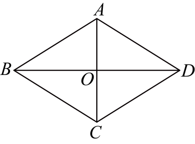

# Mathematics - 题目 1619

**ID**: 09d46e5115004507b339587ddc230082
**年级**: Grade 8
**难度**: Easy
**题型**: Calculation

## 题目
求证：对角线互相垂直且平分的四边形是菱形．如图，已知①，垂足为 $O$ ， $OA=OC$ ， $OB=OD$ ，连接 $AB$ ， $BC$ ， $CD$ ， $DA$ ．求证：②．嘉琪同学画出了图形，并写出了已知和求证的一部分，请你帮助嘉琪补全已知和求证，并写出证明过程．​​​​​​​‌

## 解答

1. 解：已知① $AC⊥BD$ ，垂足为 $O$ ， $OA=OC$ ， $OB=OD$ ，连接 $AB$ ， $BC$ ， $CD$ ， $DA$ ．
2. 求证：②四边形 $ABCD$ 是菱形．
3. 证明： $\because OA=OC$ ， $OB=OD$ ，
4. $\therefore $ 四边形 $ABCD$ 为平行四边形，
5. $\because AC\bot BD$
6. $\therefore $ 四边形 $ABCD$ 为菱形

## 知识点

**中文**:
  - 菱形的判定

**English**:
  - Determination of Rhombuses

---
