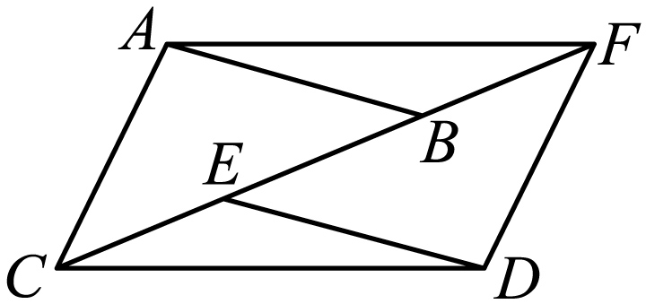

# Mathematics - 题目 3629

**ID**: 1ee7f05bd9b24ebcb80603e4a6c76573
**年级**: Grade 8
**难度**: Easy
**题型**: Calculation

## 题目
如图，点C，E，B，F在同一条直线上， $AB=DE，AC=DF，BF=CE$ ．说明 $AC{\rm{/\mskip-4mu/}}DF$ ．​​​​​​​‌

## 解答

1. 说明：∵ $CE=BF$ ，
2. ∴ $CE+BE=BF+BE$ ，即 $BC=EF$ ，
3. 又∵ $AB=DE ，AC=DF$ ，
4. ∴ $\mathrm{△}ABC≌\mathrm{△}DEF\left ({{\rm{S}}{\rm{S}}{\rm{S}}}\right )$ ，
5. ∴ $\angle ACB=\angle DFE$ ，
6. ∴ $AC{\rm{/\mskip-4mu/}}DF$ ．

## 知识点

**中文**:
  - 全等三角形的判定与性质
  - 内错角相等两直线平行

**English**:
  - Determination and Properties
  - Parallel if Alternate Interior Angles Equal

---
