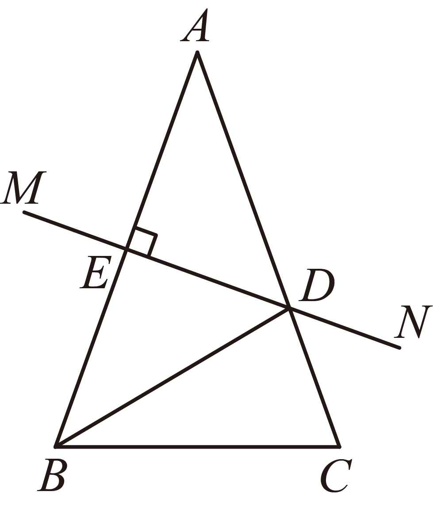

# Mathematics - 题目 3037

**ID**: 36b522f541b54829ba361384bb4c9818
**年级**: Grade 8
**难度**: Easy
**题型**: Calculation

## 题目
如图，在 $\vartriangle ABC$ 中， $AB$ 的垂直平分线 $MN$ 交 $AB$ 于点E，交 $AC$ 于点D，且 $AC=15{\rm{c}}{\rm{m}}，\mathrm{△}BCD$ 的周长等于 ${{2}}{{5}}{\rm{c}}{\rm{m}}$ ．（1）求 $BC$ 的长；​​​​​​​‌（2）若 $\angle A=36{}\degree $ ， $\angle ABC=\angle C$ ，求 $∠DBC$ 的度数．

## 解答

1. （1）解：∵ $AB$ 的垂直平分线 $MN$ 交 $AB$ 于点E，交 $AC$ 于点D，
2. ∴ $AD=BD$ ，
3. ∵ $\mathrm{△}BCD$ 的周长等于 ${{2}}{{5}}{\rm{c}}{\rm{m}}$ ，
4. ∴ $BC+BD+CD=25{\rm{c}}{\rm{m}}$ ，
5. ∴ $BC+AD+CD=25{\rm{c}}{\rm{m}}$ ，即 $BC+AC=25{\rm{c}}{\rm{m}}$
6. 又∵ $AC=15{\rm{c}}{\rm{m}}$ ，
7. ∴ $BC=10{\rm{c}}{\rm{m}}$ ；
8. （2）解：∵ $\angle A=36{}\degree $ ， $\angle ABC=\angle C$ ，
9. ∴ $\angle ABC=\angle C=\frac {180{}\degree -\angle A}{2}=72{}\degree $ ，
10. ∵ $AB$ 的垂直平分线 $MN$ 交 $AB$ 于点E，交 $AC$ 于点D，
11. ∴ $AD=BD$ ，
12. ∴ $\angle DBA=\angle A=36{}\degree $ ，
13. ∴ $\angle DBC=\angle ABC-\angle DBA=36{}\degree $ ．

## 知识点

**中文**:
  - 三角形内角和定理
  - 等腰三角形的性质
  - 线段垂直平分线的性质

**English**:
  - Angle Sum Theorem
  - Properties of Isosceles Triangles
  - Properties of Perpendicular Bisectors

---
