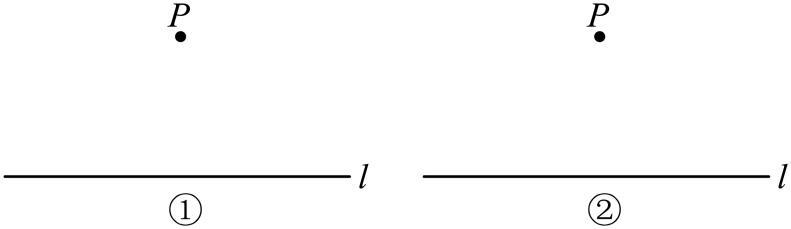

# Mathematics - 题目 1262

**ID**: 4b7a9c4d6b014b1cb25831792292b20a
**年级**: Grade 8
**难度**: Easy
**题型**: Calculation

## 题目
已知 $P$ 为直线 $l$ 外一点，利用直尺和圆规在 $l$ 上作点 $A$ ， $B$ ，分别满足下列条件．（保留作图痕迹，不写作法）(1)在图①中， $PA=PB$ ， $\angle APB=90{}\degree $ ，(2)在图②中， $PA=PB$ ， $\angle APB=60{}\degree $ ．​​​​​​​‌

## 解答

1. （1）解：如图， $PA$ ， $PB$ ， $\angle APB$ 即为求作的线段与直角；
2. 
3. （2）如图，线段 $PA$ ， $PB$ ， $\angle APB$ 即为求作的线段与 $60{}\degree $ 角.
4. 

## 知识点

**中文**:
  - 尺规作图——作线段垂直平分线
  - 等边三角形的判定与性质
  - 直角三角形斜边上的中线

**English**:
  - Construction: Perpendicular Bisector
  - Determination and Properties
  - Median to Hypotenuse of Right Triangle

---
