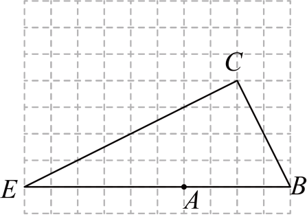

# Mathematics - 题目 3142

**ID**: 5c56ed094dba4aabb2fa187d76abca7e
**年级**: Grade 8
**难度**: Easy
**题型**: Calculation

## 题目
如图，小明在方格纸中选择格点作为顶点画 $▱ABCD$ 和 $\vartriangle BCE$ ．(1)请你在方格纸中找到点 $D$ ，补全 $▱ABCD$ ；​​​​​​​‌(2)若每个正方形小格的边长为1，请计算线段 $CE$ 的长度并判断 $AD$ 与 $CE$ 的位置关系，并说明理由．

## 解答

1. （1）解：如图所示，即为所求；
2. ∵ $AB=CD，AB/\mskip-4mu/CD$ ，
3. ∴四边形 $ABCD$ 是平行四边形；
4. 
5. （2）解： $AD\bot CE$ ，理由如下：
6. 由勾股定理得 $CE{^{2}}=4{^{2}}+8{^{2}}=80$ ， $BC{^{2}}=2{^{2}}+4{^{2}}=20$ ， $BE{^{2}}=10{^{2}}=100$ ，
7. ∴ $CE=4\sqrt {5}$ ， $CE{^{2}}+BC{^{2}}=BE{^{2}}$ ，
8. ∴ $\vartriangle BCE$ 是直角三角形，即 $\angle BCE=90{}^\circ $ ，
9. ∴ $BC\bot CE$
10. ∵四边形 $ABCD$ 是平行四边形，
11. ∴ $AD{\rm{/\mskip-4mu/}}BC$ ，
12. ∴ $AD\bot CE$ ．

## 知识点

**中文**:
  - 勾股定理
  - 勾股定理的逆定理
  - 平行四边形的判定与性质

**English**:
  - Pythagorean Theorem
  - Converse of Pythagorean Theorem
  - Determination and Properties

---
