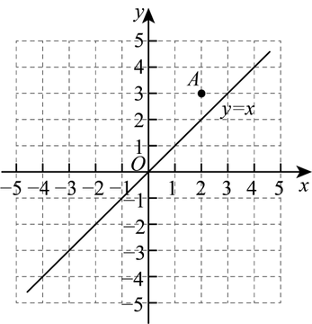

# Mathematics - 题目 1250

**ID**: 88777f63a55a4a168390cf84044e7ea2
**年级**: Grade 8
**难度**: Easy
**题型**: Calculation

## 题目
已知，如图：(1)写出点 $\mathrm{A}$ 的坐标；​​​​​​​‌(2)画出点 $\mathrm{A}$ 关于原点的对称点 $B$ ；(3)画出点 $\mathrm{A}$ 关于直线 $y=x$ 的对称点 $C$ ；(4)以点 $A、B、C$ 为顶点的三角形形状是三角形， $\vartriangle ABC$ 的面积．

## 解答

1. （1）解：由图可得，点 $\mathrm{A}$ 的坐标为 $\left ({2,3}\right )$
2. （2）解：如图，点 $B$ 即为所求；
3. 
4. （3）解：如图，点 $C$ 即为所求；
5. 
6. （4）解：由勾股定理得， $AB=\sqrt {4{^{2}}+6{^{2}}}=2\sqrt {13}$  ， $AC=\sqrt {1{^{2}}+1{^{2}}}=\sqrt {2}$ ， $BC=\sqrt {5{^{2}}+5{^{2}}}=5\sqrt {2}$ ，
7. ∴ $AB{^{2}}=AC{^{2}}+BC{^{2}}$ ，
8. ∴ $\angle ACB\mathrm{=}90{}\degree $ ，
9. $\therefore \vartriangle ABC$ 为直角三角形，
10. ∴ $\vartriangle ABC$ 的面积为 $\frac {1}{2}BC\cdot AC=\frac {1}{2}\times 5\sqrt {2}\times \sqrt {2}=5$

## 知识点

**中文**:
  - 坐标与图形变化——轴对称

**English**:
  - Coordinates and Axial Symmetry

---
