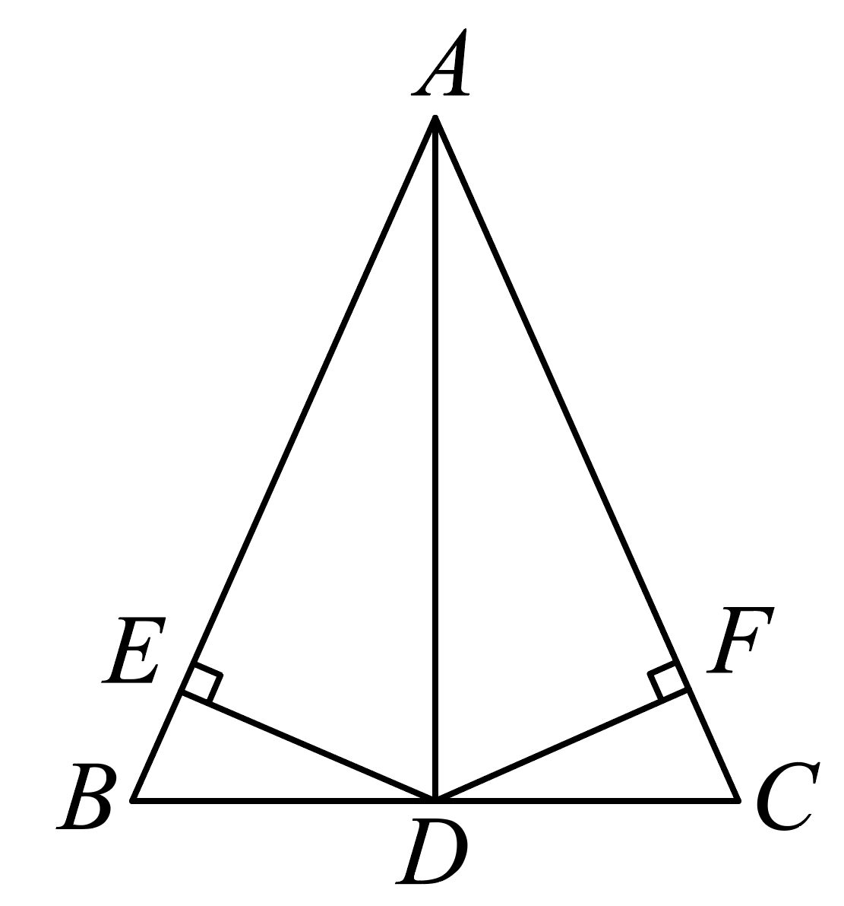

# Mathematics - 题目 568

**ID**: 955770b6cd1e4bf7834f64ca5069df09
**年级**: Grade 8
**难度**: Easy
**题型**: Calculation

## 题目
如图，在 $\vartriangle ABC$ 中， $AD$ 平分 $∠BAC$ ，点 $D$ 是 $BC$ 的中点， $DE⊥AB$ 于点 $E$ ， $DF⊥AC$ 于点 $F$ ．求证： $\angle B=\angle C$ ．​​​​​​​‌

## 解答

1. 证明： $\because AD$ 平分 $∠BAC$ ， $DE⊥AB$ ， $DF⊥AC$ ，
2. $\therefore DE=DF$ ， $\angle BED=\angle CFD=90{}\degree $ ，
3. $\because D$ 是 $BC$ 的中点，
4. $\therefore BD=CD．$
5. 在 ${\rm{R}}{\rm{t}}\mathrm{△}BDE$ 和 ${\rm{R}}{\rm{t}}\mathrm{△}CDF$ 中，
6. $\begin{cases}BD=CD\\DE=DF\end{cases}$ ，
7. ∴ ${\rm{R}}{\rm{t}}\mathrm{△}BDE≌{\rm{R}}{\rm{t}}\mathrm{△}CDF\left ({{\rm{H}}{\rm{L}}}\right )$ ，
8. $\therefore \angle B=\angle C$ ．

## 知识点

**中文**:
  - 全等三角形的判定与性质
  - 角平分线的性质

**English**:
  - Determination and Properties
  - Properties of Angle Bisectors

---
