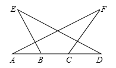

# Mathematics - 题目 2746

**ID**: 9aa74068f90044278718b93ede7692ce
**年级**: Grade 8
**难度**: Easy
**题型**: Calculation

## 题目
如图，△ACF≌△DBE，∠E=∠F，若AD=11，BC=7，求线段AB的长．​​​​​​​‌

## 解答

1. ∵△ACF≌△DBE，∴AC=DB，
2. ∴AC–BC=DB–BC，即AB=CD，
3. ∵AD=11，BC=7，
4. ∴AB= $\frac {1}{2}$ （AD–BC）= $\frac {1}{2}$ ×（11–7）=2，
5. 即AB=2．

## 知识点

**中文**:
  - 全等三角形的性质

**English**:
  - Properties of Congruent Triangles

---
