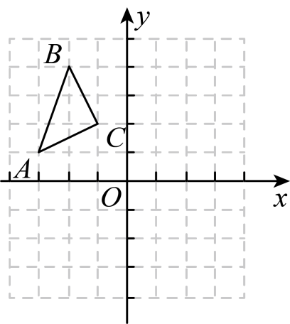

# Mathematics - 题目 2068

**ID**: a8e00f812d4144378b971963931d19e0
**年级**: Grade 8
**难度**: Easy
**题型**: Calculation

## 题目
如图，在平面直角坐标系中， $\vartriangle ABC$ 的三个顶点坐标为 $A\left ({-3,1}\right )$ ， $B\left ({-2.​​​​​​​‌4}\right )$ ， $C\left ({-1,2}\right )$ ．(1)在图中作出 $\vartriangle ABC$ 关于 $y$ 轴对称的图形 $\vartriangle DEF$ ，并写出 $D$ ， $E$ ， $F$ 的坐标．（A， $B$ ， $C$ 的对应点分别为 $D$ ， $E$ ， $F$ ）(2)求 $\vartriangle ABC$ 的面积．

## 解答

1. （1）如图所示:
2. 
3. ∴ $D\left ({3,1}\right )$ ，  $E\left ({2,4}\right )$ ，  $F\left ({1,2}\right )$ ；
4. （2）解： $\vartriangle ABC$ 的面积 $=2\times 3-\frac {1}{2}\times 3\times 1-\frac {1}{2}\times 2\times 1-\frac {1}{2}\times 2\times 1=\frac {5}{2}$ ．

## 知识点

**中文**:
  - 坐标与图形变化——轴对称
  - 画轴对称图形

**English**:
  - Coordinates and Axial Symmetry
  - Drawing Axially Symmetric Figures

---
