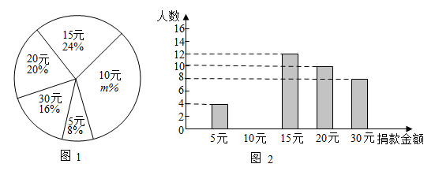

# Mathematics - 题目 2047

**ID**: ae437c0927014bb3acc607368571b1ea
**年级**: Grade 8
**难度**: Easy
**题型**: Calculation

## 题目
某校学生会向全校3000名学生发起了“爱心捐助”捐款活动，为了解捐款情况，学生会随机调查了部分学生的捐款金额，并用得到的数据绘制了如图所示的统计图：请根据相关信息，解答下列问题：（1）本次接受随机调查的学生人数为；​​​​​​​‌（2）图1中m的值是，并补全条形统计图；（3）本次调查获取的样本数据的众数是；中位数是；（4）根据样本数据，估计该校本次活动一共捐款多少元？

## 解答

1. 解：（1）本次接受随机调查的学生人数= $\frac {10}{20\%}$ =50；
2. （2）∵50-12-10-8-4=16，∴ $\frac {16}{50}{\rm{=}}32\%$ ；
3. 补图如下
4. 
5. （3）∵10元的频数为16，最大，∴众数为10；
6. 将数据排列如下 5,10,15,20,30，
7. ∴中位数应是第25，第26个数据的平均数，
8. 即 $\frac {15{\rm{+}}15}{2}{\rm{=}}15$ ；
9. （4）根据题意，得
10. $\frac {5\times 4+10\times 16+12\times 15+20\times 10+30\times 5}{50}\times 3000$
11. $=16\times 3000=48000$ 元
12. 答：估计该校本次活动一共捐款48000元.

## 知识点

**中文**:
  - 中位数
  - 用样本估计总体
  - 条形统计图
  - 扇形统计图

**English**:
  - Median
  - Estimating Population from Sample
  - Bar Charts
  - Pie Charts

---
