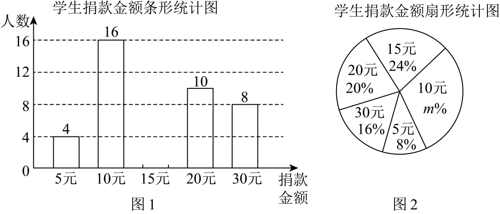

# Mathematics - 题目 2236

**ID**: b29cec4c0041473fba6908da9be40e13
**年级**: Grade 8
**难度**: Easy
**题型**: Calculation

## 题目
2025年3月28日14时20分，缅甸发生7.​​​​​​​‌9级地震，为救助灾区，某校学生会向全校学生发起了爱心捐款活动，为了解捐款情况，学生会随机调查了部分学生的捐款金额，并用得到的数据绘制了如下不完整的统计图1和图2．请根据相关信息，解答下列问题：（1）补全条形统计图；（2）本次抽取的学生捐款的众数是元，中位数是元；（3）求本次抽取的学生捐款的平均金额；（4）若该校有2000名学生，根据以上信息，估计该校本次活动捐款金额为20元的学生有多少人．

## 解答

1. （1）解：本次抽取的学生人数为 $4\div 8\%=50$ （人），
2. 则捐款金额为 $15$ 元的学生人数为 $24\%\times 50=12$ （人），
3. 补全条形统计图如下：
4. ．
5. （2）解：∵本次抽取的学生捐款金额为10元的人数最多，
6. ∴本次抽取的学生捐款的众数是10元，
7. 将本次抽取的学生捐款金额从小到大进行排序后，第25个数和第26个数的平均数即为中位数，
8. ∵ $4+16=20$ ， $4+16+12=32$ ，
9. ∴其中位数为 $\frac {15+15}{2}=15$ .
10. （3）解： $\frac {5\times 4+10\times 16+15\times 12+20\times 10+30\times 8}{50}=16$ （元），
11. 答：本次抽取的学生捐款的平均金额为16元．
12. （4）解： $2000\times 20\%=400$ （人），
13. 答：估计该校本次活动捐款金额为20元的学生有400人．

## 知识点

**中文**:
  - 扇形统计图
  - 用样本估计总体
  - 条形统计图

**English**:
  - Pie Charts
  - Estimating Population from Sample
  - Bar Charts

---
