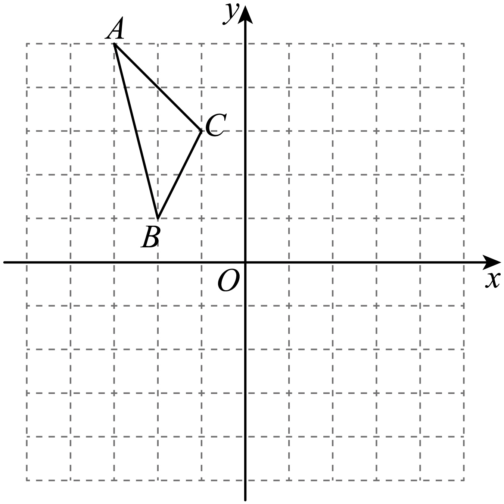

# Mathematics - 题目 3859

**ID**: bfe837408cef4ab0a2a3e78b7181a45d
**年级**: Grade 8
**难度**: Easy
**题型**: Calculation

## 题目
如图，在平面直角坐标系中，已知 ${\rm △\mathit{ABC}}$ 的三个顶点的坐标分别为A（﹣3，5），B（﹣2，1），C（﹣1，3）．（1）若 ${\rm △\mathit{ABC}}$ 和 ${\rm △\mathit{A}\mathit{_{1}}\mathit{B}\mathit{_{1}}\mathit{C}\mathit{_{1}}}$ 关于x轴成轴对称，画出 ${\rm △\mathit{A}\mathit{_{1}}\mathit{B}\mathit{_{1}}\mathit{C}\mathit{_{1}}}$（2）点C_{1}的坐标为_，△ABC的面积为_．​​​​​​​‌

## 解答

1. 解：（1）如图，△A_{1}B_{1}C_{1}为所作；
2. 
3. （2）点C_{1}的坐标为（﹣1，﹣3），
4. ${\rm △\mathit{ABC}}$ 的面积＝2×4﹣ $\frac {1}{2}{\rm ×2×2}$ ﹣ $\frac {1}{2}{\rm ×2×1}$ ﹣ $\frac {1}{2}{\rm ×4×1＝3}$ ．

## 知识点

**中文**:
  - 坐标与图形变化——轴对称
  - 画轴对称图形

**English**:
  - Coordinates and Axial Symmetry
  - Drawing Axially Symmetric Figures

---
