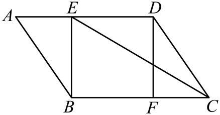

# Mathematics - 题目 2852

**ID**: c4776eb299e9460b944388eea3b72ef3
**年级**: Grade 8
**难度**: Easy
**题型**: Calculation

## 题目
如图，在平行四边形 $ABCD$ 中，E,F分别是 $AD$ , $BC$ 边上的点，且 $\angle ABE=\angle CDF$ ．(1)求证：四边形 $BEDF$ 是平行四边形；​​​​​​​‌(2)连接 $CE$ ，若 $CE$ 平分 $\angle DCB$ ， $DF\bot BC$ ， $DF=4$ ， $DE=5$ ，求平行四边形 $ABCD$ 的周长．

## 解答

1. （1）证明： $\because $ 四边形 $ABCD$ 为平行四边形，
2. $∴AD\mathrm{/\mskip-4mu/}BC$ ， $AD=BC$ ， $\angle A=\angle DCF$ ， $AB=CD$ ，
3. $\because \angle ABE=\angle CDF$ ，
4. $\therefore \vartriangle ABE≌\vartriangle CDF\left ({{\rm{A}}{\rm{S}}{\rm{A}}}\right )$ ，
5. $\mathrm{∴}AE\mathrm{=}CF$ ，
6. $\therefore AD-AE=BC-CF$ ，即 $DE=BF$ ，
7. $\because DE{\rm{/\mskip-4mu/}}BF$ ，
8. $\therefore $ 四边形 $BEDF$ 是平行四边形；
9. （2） $\because $ 四边形 $BEDF$ 是平行四边形，
10. $\therefore BF=DE$ ，
11. $\because $ 四边形 $ABCD$ 是平行四边形，
12. ${\rm .}\therefore AB=CD，AD=BC，AD{\rm{/\mskip-4mu/}}BC$ ，
13. $\therefore \angle DEC=\angle ECB$ ，
14. $\because CE$ 平分 $\angle DCB$ ，
15. $\therefore ∠DCE=∠ECB$ ，
16. $\therefore \angle DEC=\angle DCE$ ，
17. $\therefore DE=CD=5$ ，
18. $\therefore BF=DE=5$ ，
19. $\because DF\bot BC$ ，
20. $\therefore CF=\sqrt {DC{^{2}}-DF{^{2}}}=\sqrt {5{^{2}}-4{^{2}}}=3$ ，
21. $\therefore BC=BF+FC=5+3=8$ ，
22. $\therefore $ 平行四边形 $ABCD$ 的周长 $=2\left ({BC+CD}\right )=2\times \left ({8+5}\right )=26$ ．

## 知识点

**中文**:
  - 全等三角形的判定与性质
  - 等腰三角形的判定
  - 平行四边形的判定与性质

**English**:
  - Determination and Properties
  - Determination of Isosceles Triangles
  - Determination and Properties

---
