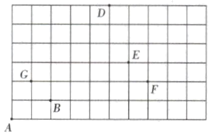

# Mathematics - 题目 2092

**ID**: d7da65384fc94ea1a53c14b4e1f33665
**年级**: Grade 8
**难度**: Easy
**题型**: Calculation

## 题目
如图所示，在边长为1的 $10\times 6$ 方格中,（1）如果用 $(0,0)$ 表示点A的位置，用 $(2,1)$ 表示点B的位置，那么点E的位置可用来表示，点D的位置可用来表示，可用 $(1,2)$ 表示点的位置；（2）如果用 $(0,0)$ 表示点G的位置，用 $(4,4)$ 表示点D的位置，那么点E的位置可用来表示点B的位置可用来表示，可用 $(6,0)$ 来表示点的位置.​​​​​​​‌

## 解答

1. （1）根据A点为原点，可知点E的位置可表示为 $(6,3)$  ，点D的位置可表示为 $(5,6)$ ， $(1,2)$ 表示点G的位置.（2）以点G的位置为原点，可知点E的位置可表示为 $(5,1)$  ，点B的位置可表示为 $(1,-1)$ ， $(6,0)$ 表示点F的位置.
2. 故答案为（1） $(6,3)$  ，  $(5,6)$  ， G；（2） $(5,1)$ ，   $(1,-1)$  ，F.
3. 【刷有所得】本题考查了坐标确定位置及位置确定坐标，熟记平面直角坐标系的概念是解题的关键.

## 知识点

**中文**:
  - 坐标确定位置

**English**:
  - Position by Coordinates

---
