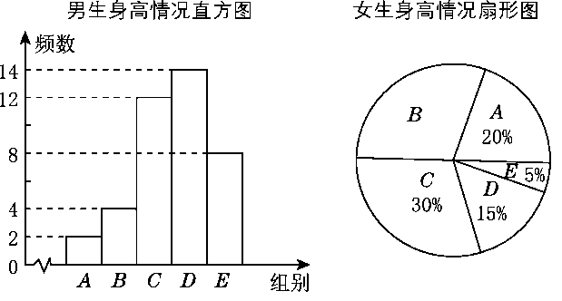

# Mathematics - 题目 1110

**ID**: e5a5d84363e94e008655a7e53d4f34a9
**年级**: Grade 8
**难度**: Easy
**题型**: Calculation

## 题目
为了了解江城中学学生的身高情况，随机对该校男生、女生的身高进行抽样调查．已知抽取的样本中，男生、女生的人数相同，根据所得数据绘制成如图所示的统计图表．组别身高(cm)Ax<150B150⩽x＜155C155⩽x＜160D160⩽x＜165Ex⩾165根据图表中提供的信息，回答下列问题：(1)在样本中，男生身高的中位数落在组(填组别序号)，女生身高在B组的人数有人；​​​​​​​‌(2)在样本中，身高在150⩽x＜155之间的人数共有人，身高人数最多的在组(填组别序号)；(3)已知该校共有男生500人、女生480人，请估计身高在155⩽x＜165之间的学生有多少人

## 解答

1. 解：（1）因为在样本中，共有男生2+4+8+12+14=40（人），
2. 所以中位数是第20、21个人身高的平均数，而2+4+12=18人，
3. 所以男生身高的中位数位于D组，
4. 女生身高在B组的人数有40×(1-30%-20%-15%-5%)=12（人）.
5. （2）在样本中，身高在150⩽x＜155之间的人数共有4+12=16（人），身高人数最多的在C组；
6. （3）500×  $\frac {12+14}{40{\rm{ }}}$ +480×(30%+15%)=541（人），
7. 故估计身高在155⩽x＜165之间的学生约有541人.

## 知识点

**中文**:
  - 扇形统计图
  - 条形统计图

**English**:
  - Pie Charts
  - Bar Charts

---
