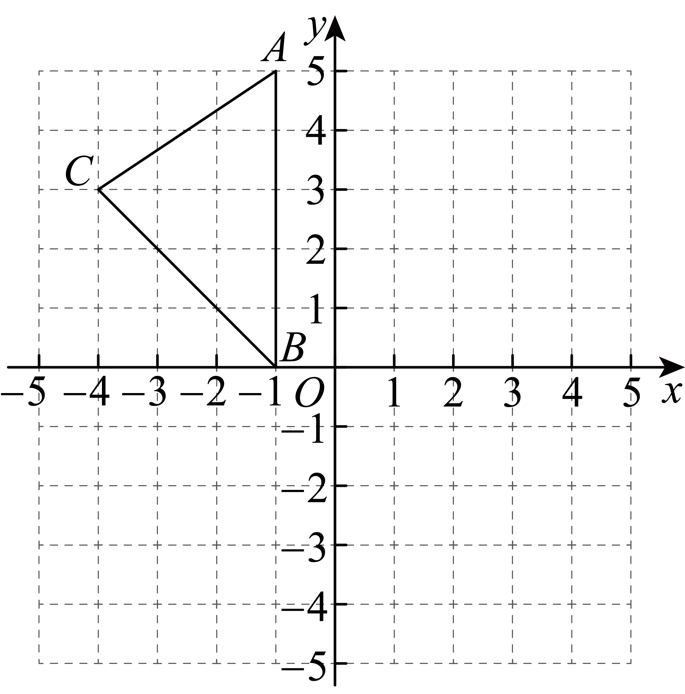

# Mathematics - 题目 864

**ID**: ef528e1b2838421a8f1d4ace52a2a563
**年级**: Grade 8
**难度**: Easy
**题型**: Calculation

## 题目
如图，在平面直角坐标系中， $A\left ({-1,5}\right )，B\left ({-1,0}\right )，C\left ({-4,3}\right )$ ．（1）求出 $\vartriangle ABC$ 的面积；​​​​​​​‌（2）在图中作出 $\vartriangle ABC$ 关于y轴的对称图形 $\mathrm{△}A{{}_{1}}B{{}_{1}}C{{}_{1}}$ ；（3）写出点 $A{{}_{1}}，B{{}_{1}}，C{{}_{1}}$ 的坐标．

## 解答

1. （1）解：由题意得， $S{{}_{△ABC}}=3\times 5-\frac {1}{2}\times 3\times 3-\frac {1}{2}\times 2\times 3=7.5$ ；
2. （2）解：如图所示， $\mathrm{△}A{{}_{1}}B{{}_{1}}C{{}_{1}}$ 即为所求；
3. 
4. （3）解：由（2）可得 $A{{}_{1}}\left ({1,5}\right )，B{{}_{1}}\left ({1,0}\right )，C{{}_{1}}\left ({4,3}\right )$ ．

## 知识点

**中文**:
  - 坐标与图形变化——轴对称
  - 画轴对称图形

**English**:
  - Coordinates and Axial Symmetry
  - Drawing Axially Symmetric Figures

---
