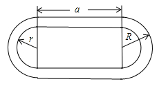

# Mathematics - 题目 2563

**ID**: ac2b8251b8a74451a140a98cf07d0788
**年级**: Grade 8
**难度**: Easy
**题型**: 拓广探索

## 题目
如图，运动场两端的半圆形跑道外径为R，内径为r，中间为直跑道，整个跑道总面积为S，试用含S，R，r的式子表示直跑道的长a．​​​​​​​‌

## 解答

1. 解： $\because $ 跑道圆环的面积是 $πR{^{2}}-πr{^{2}}$ ，
2. ∴两个直跑道的面积是 $S-\left ({πR{^{2}}-πr{^{2}}}\right )$ ，
3. $\therefore a=\frac {S-\left ({πR{^{2}}-πr{^{2}}}\right )}{2R-2r}=\frac {S-πR{^{2}}+πr{^{2}}}{2R-2r}$ ．

## 知识点

**中文**:
  - 列代数式（分式）

**English**:
  - Writing Rational Expressions

---
