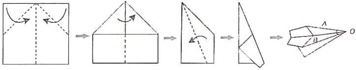

# Mathematics - 题目 3720

**ID**: 06505ad3ffa3430584c6c7cb53f329b4
**年级**: Grade 8
**难度**: Easy
**题型**: Fill-in-the-blank

## 题目
小明将一张正方形纸片按如图所示顺序折叠成纸飞机，当机翼展开在同一平面时(机翼间无缝隙)， $\angle AOB$ 的度数是.​​​​​​​‌

## 解答

1. 在折叠过程中角一直是轴对称的折叠，
2. $\angle AOB=22.5^\circ \times 2=45^\circ $
3. 故答案为45°

## 知识点

**中文**:
  - 轴对称的性质

**English**:
  - Properties of Axial Symmetry

---
