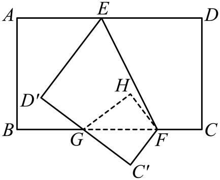

# Mathematics - 题目 598

**ID**: 0f934972cc214856acd463dbb79bc321
**年级**: Grade 8
**难度**: Easy
**题型**: Fill-in-the-blank

## 题目
如图，将长方形纸片 $ABCD$ 沿折痕 $EF$ 折叠，点D，C的对应点分别为点 $D^{′}$ ， $C^{′}$ ， $C{^{\prime }}D{^{\prime }}$ 交 $BC$ 于点G，再把三角形 $GC^{′}F$ 沿 $GF$ 折叠，点 $C^{′}$ 的对应点为点H，若 $\angle D^{′}GH=104{}\degree $ ， $\angle DED^{′}$ 的度数是．​​​​​​​‌

## 解答

1. 解：∵ $\angle D^{′}GH=104{}\degree $ ，
2. ∴ $\angle C^{′}GH=180{}\degree -\angle D^{′}GH=76{}\degree $ ，
3. 根据折叠可知： $\angle CGF=\angle HGF$ ， $\angle C^{′}=\angle C=\angle H=90{}\degree $ ， $\angle CFE=\angle C^{′}FE$ ，
4. $\angle DEF=\angle D^{′}EF$ ，
5. ∴ $\angle C^{′}GF=\angle HGF=\frac {1}{2}\angle C^{′}GH=38{}\degree $ ，
6. ∴ $\angle GFC^{′}=180{}\degree -90{}\degree -38{}\degree =52{}\degree $ ，
7. ∴ $\angle CFE=\angle C^{′}FE=\frac {1}{2}\left ({360{}\degree -180{}\degree +52{}\degree }\right )=116{}\degree $ ，
8. ∵长方形纸片中 $AD{\rm{/\mskip-4mu/}}BC$ ，
9. ∴ $\angle DEF=180{}\degree -\angle CFE=64{}\degree $ ，
10. ∴ $\angle DEF=\angle D^{′}EF=64{}\degree $ ，
11. ∴ $\angle DED^{′}=2\times 64{}\degree =128{}\degree $ ．

## 知识点

**中文**:
  - 两直线平行同旁内角互补
  - 对顶角、邻补角
  - 折叠问题

**English**:
  - Parallel Lines have Supplementary Consecutive Angles
  - Vertical and Adjacent Angles
  - Folding Problems

---
