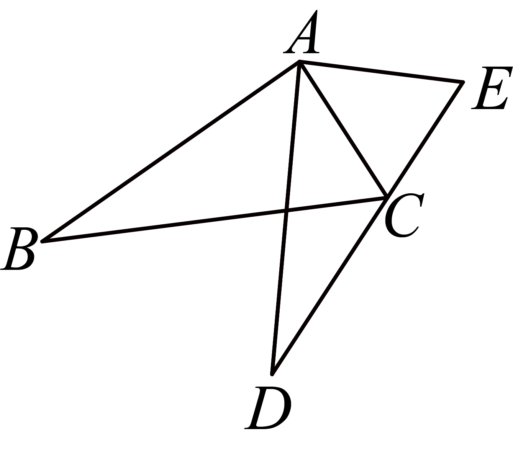

# Mathematics - 题目 2005

**ID**: 2b115ec618c14bb5be9817c0fc4e5ae3
**年级**: Grade 8
**难度**: Easy
**题型**: Fill-in-the-blank

## 题目
如图， $AB=AD，AC=AE$ ，且点C在 $DE$ 上， $\angle BAD=\angle CAE=50{}\degree $ ，则 $\angle BCD=$​​​​​​​‌

## 解答

1. 解： $\because \angle BAD=\angle CAE=50{}\degree $ ．
2. $\therefore \angle BAD+\angle CAD=\angle CAE+\angle CAD$ ．
3. $\therefore \angle BAC=\angle DAE$ ．
4. 在 $\vartriangle ABC$ 和 $\vartriangle ADE$ 中，
5. $\begin{cases}AB=AD\\\angle BAC=\angle DAE\\AC=AE\end{cases}$ ，
6. $\therefore \mathrm{△}ABC≌\mathrm{△}ADE({\rm{S}}{\rm{A}}{\rm{S}})$ ，
7. $\therefore \angle B=\angle D$ ．
8. $\because $ 对顶角相等，
9. ∴ $\angle B+\angle BAD=\angle D+\angle BCD$ ，
10. $\therefore \angle BCD=\angle BAD=50{}\degree $ ．

## 知识点

**中文**:
  - 全等三角形的判定与性质

**English**:
  - Determination and Properties

---
