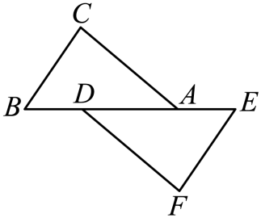

# Mathematics - 题目 291

**ID**: 43238f1bf20f4f5a98addb6fc670edaf
**年级**: Grade 8
**难度**: Easy
**题型**: Fill-in-the-blank

## 题目
如图， $\mathrm{△}ABC{\rm{≌}}\mathrm{△}DEF$ ， $AE=2$ ， $AD=3$ ，则 $AB=$．​​​​​​​‌

## 解答

1. 解：∵ $\mathrm{△}ABC\mathrm{≌}\mathrm{△}DEF$ ，
2. ∴ $AB=DE$ ，
3. ∴ $AB-AD=DE-AD$ ，
4. 即 $BD=AE=2$ ，
5. ∴ $AB=AD+DB=3+2=5$ ．

## 知识点

**中文**:
  - 全等三角形的性质

**English**:
  - Properties of Congruent Triangles

---
