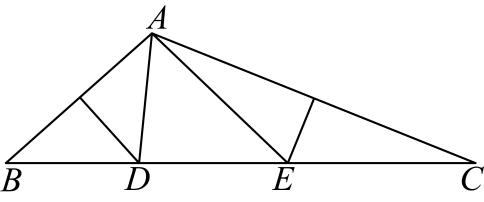

# Mathematics - 题目 2460

**ID**: 513b4aa34f2840978b37baac80bb0980
**年级**: Grade 8
**难度**: Easy
**题型**: Fill-in-the-blank

## 题目
如图，在 $\vartriangle ABC$ 中， $\angle BAC>90{}\degree $ ， $AB,AC$ 的垂直平分线分别与 $BC$ 交于点D，E，若 $BC=4$ ，则 $\vartriangle ADE$ 的周长是．​​​​​​​‌

## 解答

1. 解：∵ $AB,AC$ 的垂直平分线分别与 $BC$ 交于点D，E，
2. ∴ $DA=DB,EA=EC$ ，
3. ∴ $\vartriangle ADE$ 的周长为 $DA+DE+EA=DB+DE+EC=BC=4$ .

## 知识点

**中文**:
  - 线段垂直平分线的性质

**English**:
  - Properties of Perpendicular Bisectors

---
