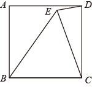

# Mathematics - 题目 2573

**ID**: 55e0a5474c114574addf6cfc37214e9e
**年级**: Grade 8
**难度**: Easy
**题型**: Fill-in-the-blank

## 题目
如图，点E在正方形ABCD内，且CE=CB，则 $\angle BED=$°．​​​​​​​‌

## 解答

1. 解：∵四边形ABCD是正方形，
2. ∴CB=CD，∠BCD=90°，
3. ∵CE=CB，
4. ∴CB=CE=CD，
5. ∴ $\angle BED=\angle CEB+\angle CED$
6. $=\frac {1}{2}\left ({180{}\degree -\angle ECB}\right )+\frac {1}{2}\left ({180{}\degree -\angle ECD}\right )$
7. $=180{}\degree -\frac {1}{2}\left ({\angle BCE+\angle ECD}\right )$
8. $=180{}\degree -45{}\degree =135{}\degree ．$

## 知识点

**中文**:
  - 正方形的性质

**English**:
  - Properties of Squares

---
