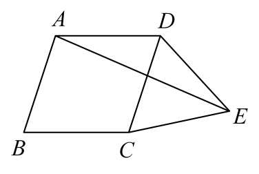

# Mathematics - 题目 1650

**ID**: 66330759318c4a71a4a7547a6c058b2e
**年级**: Grade 8
**难度**: Easy
**题型**: Fill-in-the-blank

## 题目
如图，在菱形 $ABCD$ 的外侧，作等边三角形 $CDE$ ，连接 $AE$ ．若 $\angle B=72{}\degree $ ，则 $∠AED=$度．​​​​​​​‌

## 解答

1. 解： $\because $ 四边形 $ABCD$ 是菱形， $\vartriangle CDE$ 是等边三角形，
2. $\therefore $  $\angle ADC=72{}\degree ,AD=CD,DE=CD$ ， $\angle CDE=60{}\degree $ ，
3. $\therefore $  $AD=DE$ ，
4. $\therefore $  $\vartriangle ADE$ 是等腰三角形，
5. $\because $  $\angle ADE=\angle ADC+\angle CDE=132{}\degree $ ，
6. $\therefore $  $\angle DAE=\angle AED=\frac {180{}\degree -\angle ADE}{2}=24{}\degree $

## 知识点

**中文**:
  - 三角形内角和定理
  - 等边三角形的性质
  - 菱形的性质

**English**:
  - Angle Sum Theorem
  - Properties of Equilateral Triangles
  - Properties of Rhombuses

---
