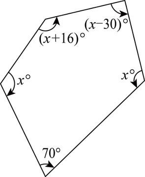

# Mathematics - 题目 1261

**ID**: 8dfdc36843d04ac9ad4f5488a24e23ec
**年级**: Grade 8
**难度**: Easy
**题型**: Fill-in-the-blank

## 题目
如图是一个五边形，图形中 $x$ 的值为${}\degree $ ．​​​​​​​‌

## 解答

1. 解：依题意， $x+70+x+x-30+x+16=\left ({5-2}\right )\times 180$
2. 解得： $x=121$

## 知识点

**中文**:
  - 多边形的内角

**English**:
  - Interior Angles of Polygons

---
