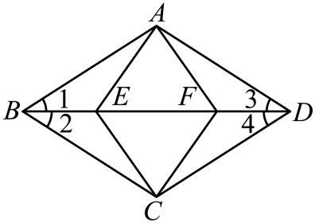

# Mathematics - 题目 603

**ID**: b9c673add57a4d0d97ef4416c37768c5
**年级**: Grade 8
**难度**: Easy
**题型**: Fill-in-the-blank

## 题目
如图， $\angle 1=\angle 2$ ， $∠{\rm{3}}{\rm{=}}∠{\rm{4}}$ ，则图中全等三角形有对．​​​​​​​‌

## 解答

1. 解：连接 $AC$ ，如图所示，
2. 
3. $\because \angle 1=\angle 2，BD=BD，\angle 3=\angle 4$ ，
4. $\therefore △ABD≌△CBD({\rm{A}}{\rm{S}}{\rm{A}})$ ，
5. $\therefore AB=BC，AD=CD$ ，
6. $\because AB=BC，\angle 1=\angle 2，BE=BE$ ，
7. $\therefore \vartriangle ABE≌\vartriangle CBE({\rm{S}}{\rm{A}}{\rm{S}})$ ，
8. $\because DF=DF，\angle 3=\angle 4$ ， $AD=CD$ ，
9. $\therefore △ADF≌△CDF({\rm{S}}{\rm{A}}{\rm{S}})$ ，
10. 同理可证： $\mathrm{△}AED≌\mathrm{△}CED$ ，
11. $\vartriangle ABF≌\vartriangle CBF$ ，
12. $\vartriangle AEF≌\vartriangle CEF$ ，则共有6对
13. 故此题答案为：6．

## 知识点

**中文**:
  - 全等三角形的判定

**English**:
  - Determination of Congruent Triangles

---
