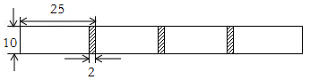

# Mathematics - 题目 3098

**ID**: c28efbccc9664323800bc7711cb8f81b
**年级**: Grade 8
**难度**: Easy
**题型**: Fill-in-the-blank

## 题目
将长为25cm、宽为10cm的长方形白纸，按如下图所示的方法粘合起来，粘合部分的宽为2cm，设x张白纸粘合后的总长度为ycm，y与x的函数关系式为．​​​​​​​‌

## 解答

1. 解：每张纸条的长度是25cm，x张应是25xcm，
2. 由图中可以看出4张纸条之间有3个粘合部分，那么x张纸条之间有（x-1）个粘合部分，应从总长度中减去．
3. ∴y=25x-（x-1）×2=23x+2，
4. 故答案为：y=23x+2.

## 知识点

**中文**:
  - 几何问题

**English**:
  - Geometry Problems

---
