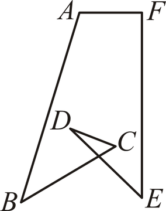

# Mathematics - 题目 1041

**ID**: c9d05e4f638d46ba90f3343c7cbc40cf
**年级**: Grade 8
**难度**: Easy
**题型**: Fill-in-the-blank

## 题目
如图， $\angle A+\angle B+\angle C+\angle D+\angle E+\angle F$ 的度数为．​​​​​​​‌

## 解答

1. 解：如图，连接 $BE$ ．
2. $\because \angle 1=\angle C+\angle D$ ， $\angle 1=\angle CBE+\angle DEB$ ，
3. $\therefore \angle C+\angle D=\angle CBE+\angle DEB$ ，
4. $\therefore \angle A+\angle ABC+\angle C+\angle D+\angle DEF+\angle F$  $=\angle A+\angle ABC+\angle CBE+\angle DEB+\angle DEF+\angle F$
5. $=\angle A+\angle ABE+\angle BEF+\angle F$ ．
6. $\because \angle A+\angle ABE+\angle BEF+\angle F=360{}\degree $ ，
7. $\therefore \angle A+\angle ABC+\angle C+\angle D+\angle DEF+\angle F=360{}\degree $ ．
8. 答案为： $360{}\degree $ ．
9. 

## 知识点

**中文**:
  - 三角形内角和定理
  - 多边形的内角

**English**:
  - Angle Sum Theorem
  - Interior Angles of Polygons

---
