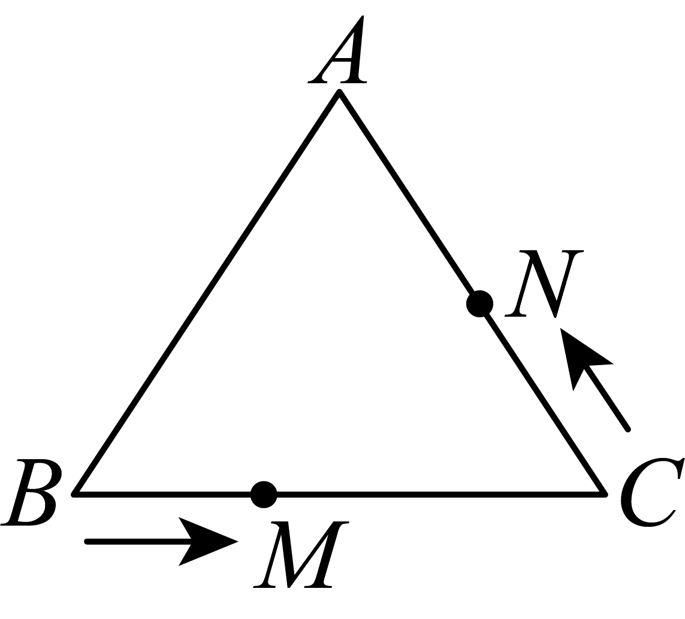

# Mathematics - 题目 2630

**ID**: caf340e94b0a4300a36af3f99af9fde7
**年级**: Grade 8
**难度**: Easy
**题型**: Fill-in-the-blank

## 题目
如图，在 $\vartriangle ABC$ 中， $AB=AC=BC=6$ ，点 $M$ 从点 $B$ 出发向点 $C$ 运动，速度为每秒1个单位长度，点 $N$ 从点 $C$ 出发向点 $A$ 运动，速度为每秒1.​​​​​​​‌5个单位长度，当其中一点到达终点时，另一点随之停止运动，设运动时间为 $t$ 秒，当 $△MCN$ 为直角三角形时， $t=$

## 解答

1. 解： $\because AB=AC=BC=6$ ，
2. $\therefore \vartriangle ABC$ 是等边三角形，
3. $\therefore \angle C=60{}\degree $ ．
4. ∵ $△MCN$ 为直角三角形，
5. $\therefore \angle NMC=90{}\degree $ 或 $\angle MNC=90{}\degree $ ．
6. ①设运动时间为 $t{{}_{1}}{\rm{s}}$ 时， $\angle NMC=90{}\degree $ ，
7. $\because \angle C=60{}\degree $ ，
8. $\therefore \angle CNM=30{}\degree $ ，
9. $\therefore 2CM=CN$ ，
10. $\therefore 2\left ({6-t{{}_{1}}}\right )=1.5t{{}_{1}}$ ，
11. 解得 $t{{}_{1}}=\frac {24}{7}$ ；
12. ②设运动时间为 $t{{}_{2}}{\rm{s}}$ 时， $\angle MNC=90{}\degree $ ，
13. $\because \angle C=60{}\degree $ ，
14. $\therefore \angle CMN=30{}\degree $ ，
15. $\therefore 2CN=CM$ ，
16. $\therefore 2\times 1.5t{{}_{2}}=6-t{{}_{2}}$ ，
17. 解得 $t{{}_{2}}=\frac {3}{2}$ ．
18. 又 $\because 0\leqslant t\leqslant 4$ ，
19. ∴经检验， $t{{}_{1}}$ ， $t{{}_{2}}$ 符合题意．
20. 综上所述，当运动时间为 $\frac {24}{7}{\rm{s}}$ 或 $\frac {3}{2}{\rm{s}}$ 时， $△MCN$ 为直角三角形．

## 知识点

**中文**:
  - 含30度角的直角三角形
  - 等边三角形的判定与性质

**English**:
  - Right Triangle with 30° Angle
  - Determination and Properties

---
